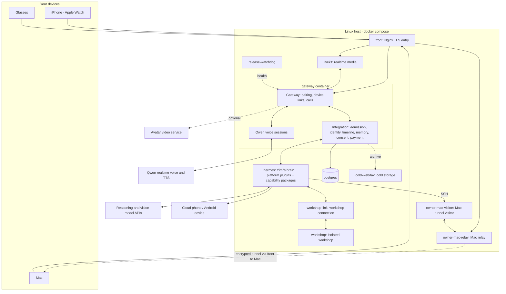

[中文](README.md) · **English**

# Yimi · Personal AI OS (Personal Agent) 0.1.5

Everyone should have their own Yimi (依米).

Yimi is a personal assistant — your own Jarvis. She lives on your phone, glasses, watch and Mac. She talks with you, takes requests, remembers what you told her and how you like things, and learns about your schedule, location and the people around you through data you authorize. Say "order the same lunch as last time" and she looks it up and does it, by default stopping right before payment to wait for your go-ahead. When she doesn't know how to do something, she looks for an existing tool and learns it; if none exists, she builds one, tests it, then uses it.

She runs on a server you deploy, uses the models you choose, and uses connected data and devices within your authorization. Models can be changed through configuration; the memory you build up with her is not cleared when the model changes.

Looking further ahead: once everyone has their own assistant, assistants could talk to each other directly, within what each user allows, to set up a dinner, find a time or split a bill. People would then need far fewer apps and platforms to get everyday things done. That is where we are heading; version 0.1.5 does not yet have complete A2A integration.

The project started in October 2026 and is licensed under Apache-2.0.

## What is new in 0.1.5

- **Local models.** Once a local catalog is configured, settings can switch speech recognition, voice activity detection, voiceprint, wake-word and embedding models after a device-signed approval, and show the selected and effective versions, the previous version, progress and errors. The deployer must configure `local_catalog_file` and supply model files, absolute paths and trusted digests; this entry point does not download models. Changing a speech model requires a service restart; changing the voiceprint model also requires re-enrollment and calibration for each capture channel in use. Embedding models need their own runtime environment and take effect only after derived indexes are rebuilt. Face models are listed, but switching them goes through the face-enrollment flow.
- **Voiceprints.** Voiceprint verification thresholds are persisted per capture channel, never decrease and have a floor of 0.65. Automatic gradual increases require enough confirmed samples from the same channel; restarting or lowering the configured value does not lower a saved threshold.
- **Speaking preferences.** Yimi can choose preset tone, expression and habit preferences in the platform preference area, up to 1,500 characters, and restore the previous version. The platform stores the versions and projects them into a read-only `memories/PERSONALITY.md`; preferences cannot change her identity, locked personality or protected rules.
- **Optional meeting assistant (end-to-end work in progress).** This version provides optional meeting-assistant server orchestration and a presentation protocol, covering slide reads, locating text from the discussion, edit previews, first-edit consent and reconciliation of unknown results. Actual Keynote reads and writes require a Mac executor that implements this protocol and returns edit-readback evidence. The included Mac source does not yet implement these tools, so enabling the package alone does not make the assistant usable. Connecting such an executor also requires a configured platform port and internal service credentials, an authorized local file, and the specified Mac and one pair of glasses online. The protocol limits edits to replacing text and appending paragraphs; the default deployment does not enable the package.

## Foundations introduced in 0.0.2

These capabilities were introduced in 0.0.2 and remain in the current version.

Version 0.0.2 organized what Yimi can do into uniform capability packages. Every capability follows the same rules for how it is connected, how it reports its result, and how it is rolled back on its own when something goes wrong. That makes new skills easier for her to pick up, and her actions easier for you to check.

- **Capability packages.** Mi Home, phone tasks, messaging, WeChat, desktop, Mac and built-in tools all connect as capability packages. Each package can be enabled and rolled back individually (single-host peripherals also need their corresponding switches enabled); actions that need consent share one consent contract, and results come back under one receipt contract. Capability packages are this project's layer on top of Hermes, not a change to upstream Hermes.
- **Workshop.** The workshop handles discovery, building and self-tests. The platform capability registry owns registration checks, publication, monitoring and per-package rollback.
- **Model settings.** Model settings have a single source of truth. A single-host deployment imports brain, vision and workshop configuration from `.env` on its first start; later starts keep the stored settings and credentials. See "Deploying" below.
- **Usage records.** Model usage is recorded separately for input, output, cache reads and cache writes; estimates and unknown usage or costs remain marked as such.
- **Memory.** On release startup, existing Hermes native core memories are imported into personal memory. After a release rollback, the older release reads a projection of the current core memory profile; a later upgrade imports only the entries added while the older release ran.
- **Clients.** Phone, watch and Mac connection, audio and interface updates ship as source; third-party SDKs and model resources are obtained separately.
- **Contributor docs.** The community-contributed Mac desktop simulator guide and the native producer test prerequisites are kept.

## What happens after one sentence

Take one example. Wearing the glasses, you say: "Yimi, tidy up the notes from today's meeting and send them to Lin." (Lin is a made-up contact.)

1. **Wake and transcribe.** The glasses hear "Yimi" with an on-device Sherpa keyword model and stream the audio to the server. On this input path, the Qwen realtime frontend only transcribes and extracts candidates; it never answers or acts. During calls, a separate voice session reads replies aloud.
2. **Admission and identity.** The Gateway receives the input and hands it to Integration, which checks the speaker's voiceprint, confirms it is you, and writes the utterance to your personal timeline. Your phone and Mac can sync and display this timeline.
3. **Think and delegate.** Yimi's "brain" is a [Hermes Agent](https://github.com/NousResearch/hermes-agent) instance running this project's `personal_aios` platform plugin and `yimi_gateway` capability gateway plugin. The runtime still carries a pinned temporary residual patch; removing it is in progress. For root agents configured with delegated toolsets, the patch applies a conversation-tool allowlist. The main agent talks, decides, reads memories needed for the conversation and manages delegation: she replies "OK, on it," then hands the work to a background subagent.
4. **Act.** The subagent calls tools: memory lookup, file reads, summarizing.
5. **First-send confirmation.** Before sending to Lin, the server checks for a precedent. The first time the same user sends the same kind of task to the same recipient, you confirm it on a card. After that, the same kind of send goes through without asking; a new recipient or a new kind of task asks again.
6. **Report back.** Yimi is instructed to say "sent" only after a real execution result comes back. Her reply goes to the timeline and syncs to your phone and Mac.

For a food order, step 4 goes to the phone executor instead. It opens the app on a cloud phone (or an Android device you connect) and taps through it. At the checkout screen the executor stops and the payment flow takes over; see "Safety contract" below.

## How she learns new things

- **Skills.** A skill is a `SKILL.md` that teaches her how to combine existing tools. The repository ships skills for food delivery, ride hailing, the cloud phone, Mi Home, the Mac desktop, memory recap and more (`integrations/hermes/personal_aios/errands/` and `capability/packages/*/skills/`).
- **Workshop.** When no tool fits, she finds, writes and tests a new skill in an isolated workshop container and publishes it only after the test passes; published skills can be reverted. The workshop runs in its own container and network and builds with a separate Hermes profile. It does not mount the everyday conversation and memory data volumes; workshop snapshots, configuration and desktop inputs remain available. New tools are built as capability packages; see [Adding capabilities](docs/skills-and-connectors.md).
- **Fixing herself.** Tell her something isn't working. Things she can change herself — phrasing, habits, skills — she changes on the spot. For product code, she can hand the problem to a separate build service. The fixed version runs the regression suite on staging, then ships at an idle moment; say "undo that" and the previous version comes back. This path requires a separately configured builder, isolated staging, a candidate repository, a release runner, credentials, snapshots and rollback. Automatic self-repair release is off in the first-run single-host entry point; see the [first-run guide](docs/first-run.md).

## What 0.1.5 contains

| Part | Delivered as | Notes |
| --- | --- | --- |
| Linux server | Source + Docker Compose | You build the images on your own host. No prebuilt images are published. |
| iPhone, Apple Watch, Mac | Source + [build guide](docs/clients.md) | Vendor assets such as the Alibaba Cloud ARTC SDK and the wake-word model are obtained separately. |
| Glasses (Android, RayNeo X series) | Source + [build guide](docs/clients.md) | The RayNeo SDK is obtained separately. This version provides source build instructions. |
| Models | Configuration | Each role has its own provider and model; see below. |

What each device does:

- **Phone:** text, voice, calls, device pairing, memory and health views, and the payment confirmation card.
- **Glasses:** voice wake, first-person photos, HUD cards, nod/shake answers, and voice payment (once enabled).
- **Watch:** talk to her from the watch, notifications, ride and workout tracking.
- **Mac:** desktop chat and screen sharing. Once paired, Yimi can read and write files, run commands and operate apps on that Mac over an encrypted relay. A keyboard shortcut pauses her control of the Mac at any time, and executed commands are logged.
- **Home:** Mi Home devices connect through a separate MCP service.

## Architecture



The main services are defined in `deploy/cloud/compose.yaml`; cold storage is defined in the referenced `compose.archive.yaml`. The main services come in `production` and `staging` profiles that use the same application images, with separate data and external-execution configuration. The single-host entry point adds `compose.single-host.yaml` and starts seven core services by default; other services in the diagram are optional. Key points:

- Only one TLS port (8443 by default for the single-host entry point) plus the WebRTC/TURN ports are exposed, all on `front`.
- Gateway, Integration and the Qwen voice sessions share one container; the process entry point is `rayneo-persistent-production-entrypoint.ts`.
- Besides Hermes itself, the `hermes` container loads MCP services through capability packages; the phone executor (built on Mobilerun), Mi Home service and Mac connection are enabled according to configuration.
- `workshop` sits on its own Docker network with a read-only root filesystem and memory and process limits, reachable only through `workshop-link`.
- Speech recognition and voiceprint models (Sherpa) and face recognition (OpenCV) run locally on the server. Completed archive data are packed and uploaded to cold storage (OpenList WebDAV). Local copies are kept for two days by default; under storage pressure, a notice precedes early cleanup of verified local copies.

For the module map and a reading order, see [the architecture guide](docs/architecture.md).

## Models are configuration

Yimi is not tied to one model vendor. Each role is configured separately. Keys never go into source or images: deployment keys live in a secrets directory and are mounted read-only into containers under `/run/secrets/`, and the provider keys for brain, vision and workshop are imported into encrypted storage on first start.

The single-host entry point configures seven roles in `deploy/cloud/.env`. Only brain is required. The example uses the official DeepSeek API; any OpenAI-compatible Chat Completions endpoint can be configured instead. Vision, executor fast, executor thorough, realtime, TTS and workshop repair are off by default. When no separate repair role is set, the workshop uses the configured brain. Brain, vision and workshop settings are imported from `.env` only on first start; after that the stored settings apply, and you change them on the client's model and key settings page. The phone executor, realtime and TTS keep reading their own read-only deployment configuration. The table below lists underlying service configuration; see the [first-run guide](docs/first-run.md) for single-host roles and protocol requirements.

| Role | Where | Default |
| --- | --- | --- |
| Main conversation, background subagents | `brain` and `delegation` roles in model settings; Hermes reads their runtime projections | Instance settings; the import example uses DeepSeek |
| Vision | `auxiliary.vision` in model settings | Instance settings; the import example uses SiliconFlow GLM, off by default in the single-host entry point |
| Realtime voice and calls | `voice_frontend` in `deploy/cloud/cloud.json` | Qwen Omni realtime |
| Read-aloud | `tts` in `cloud.json` | Qwen TTS |
| Phone executor | `integrations/connectors/phone_executor/mobilerun-config.example.yaml` | DeepSeek + GLM |

Yimi's voice comes from Qwen's speech models, called through Alibaba Cloud DashScope. This project did not train them. If you change the voice model or voice, check that the protocol and any saved voice resources still match.

## Safety contract

- **Sending:** the first time the same user sends the same kind of task to the same recipient, you confirm; the record is kept on the server. A new recipient or task type asks again. Any external action you did not ask for needs confirmation every time.
- **Payment:** each payment gets its own authorization; an earlier approval never carries over. By default every payment needs a tap on the phone's confirmation card (the phone must be unlocked, and the device signs the approval). Two options are off by default, and their amount limits are configurable:
  - *Voiceprint payment*, enabled from the phone. It requires an enrolled voiceprint, the phone and glasses lock requirements, and a valid unlock lease. Then you can confirm a recent voice request made on the same terminal by saying "付吧" ("go ahead and pay") on the phone or glasses. Defaults: known payee only, at most ¥200 per order, within the request budget.
  - *Small automatic payments.* All of these must hold: voiceprint payment enabled, a recent voiceprint-verified voice request, a valid unlock lease, a known payee, the request budget respected, at most ¥50 per order and ¥150 per day by default, and no other payment to that payee created in the past 30 minutes that is authorized, in progress, paid or of unknown outcome. The payment then goes through after a 5-second undo window.

  Anything that fails these checks falls back to the phone card.
- **What the gates cover:** capability-package tools, including packages she builds and registers herself, pass through the server capability gateway. It checks the run scope, declared effect class and required consent, and admits results against the receipt contract. Self-built packages cannot declare payment or system-change effects. This boundary covers capability calls; it does not mean every system call in an arbitrary terminal script passes through that gateway.
- **Secrets:** never in source or images. Deployment keys are mounted as files; model provider keys imported on first start are stored encrypted, and the model-settings master key is mounted only into the Gateway.
- **Costs and data:** model, cloud-phone and avatar services cost money and receive the content each task needs. Set budgets with your providers and choose them to fit your data requirements. Never publish pairing data, sessions, health data, media, consent records or runtime directories.

## Deploying

A single host needs Linux, Docker Engine, Buildx and Docker Compose 2.36 or later. Run the start command as root on the deployment host, with access to the Docker daemon. The workshop preparer allocates a dedicated 1 GiB ext4 capacity volume for the workshop and configures its mount, so the host also needs Python 3, e2fsprogs, util-linux and systemd. See the [first-run guide](docs/first-run.md) for requirements, ports, pairing and a text round trip. From the repository root, as root:

```sh
cp deploy/cloud/.env.example deploy/cloud/.env
chmod 600 deploy/cloud/.env
# Edit .env: set PAIOS_BRAIN_API_KEY and configure your host/IP as needed.
sh deploy/cloud/build.sh --up
```

This command builds images from public source, generates missing internal credentials and default self-signed TLS, applies migrations, creates the instance identity and starts seven core services. Text conversation is the default. Voice, peripherals, cold storage and avatar services need additional configuration from the guide. Existing credentials and certificates are preserved. `prepare-build.py` prepares build inputs, and `hermes-init.py` writes configured models, skill directories and MCP servers into Hermes configuration.

Model configuration in `.env` is imported only on the first start: brain, vision and workshop settings, together with their provider keys, go into the model-settings authority. Later starts keep the stored settings and credentials, and editing `.env` does not overwrite them; change models or keys on the client's model and key settings page.

Once running, `release.py` takes a new release through build, tests, staging, switch and rollback. Each host uses `current` and `previous` pointers for the current and previous releases. If a release that `release-watchdog` has taken over stays unhealthy or keeps restarting, the watchdog switches back to the previous one automatically. A rollback restores images and release files. So that the older release can still read your memory, the release rollback flow first projects the current core memory profile to it, and a later upgrade imports only the entries added during the rollback. Ordinary release rollback does not undo database migrations, client updates or external actions that already happened; if that release performed history isolation, rollback first restores its bound, completed and unexpired history cut, or resumes its bound unfinished recovery, while retaining current settings and other keep data. Back up your data before deploying (back up and restore the model-settings authority together with its master key) and rehearse a restore in an isolated environment.

## Where the code is

| Directory | Contents |
| --- | --- |
| `01-product-half-finished/backend/phase0/gateway` | Device access, pairing, realtime calls |
| `01-product-half-finished/backend/services/personal-aios-integration` | Admission, identity, timeline, memory, consent, payment |
| `capability` | Capability packages, contracts, receipt SDKs and templates |
| `integrations/hermes/personal_aios` | Hermes platform integration, persona, skills and workshop |
| `integrations/connectors/phone_executor` | Phone executor and checkout guard |
| `01-product-half-finished/apple/current-mac-source-20260930/clients/phase0/apple-native` | iPhone, watch and Mac clients |
| `01-product-half-finished/glasses-android` | Glasses client |
| `deploy/cloud` | Containers, config generation, release and data-snapshot tools |

## Contributing

Start with [CONTRIBUTING](CONTRIBUTING.md) and [the testing guide](docs/testing.md). Public CI needs no model keys; model calls in public CI hit local stubs. Using Node 24.19.0 and pnpm 11.9.0, run a quick first test from the repository root:

```sh
cd 01-product-half-finished/backend/phase0/gateway
pnpm install --frozen-lockfile
node --test tests/activity-update-contract.test.ts
```

This checks the shared protocol only. Calls, device permissions, external execution and recovery still need verifying on your own host and devices. Report security issues through the [private channel](SECURITY.md).

## License

Except where individual files or [NOTICE](NOTICE) say otherwise, the code is licensed under the [Apache License 2.0](LICENSE). The Mi Home MCP service, `capability/packages/mijia/server/mijia.py`, is GPL-3.0-or-later and runs as a separate process. The default avatar depicts an AI-generated fictional person; see NOTICE. Other third-party dependencies, models, SDKs and assets keep their own licenses.

## Details

To go deeper, read these three documents in order. They describe the same system: the technical plan covers the structure, the end-to-end flows walk through each process step by step, and the technical report explains why it is built this way and how well it works. The full texts are included below; expand a section to read it. The standalone files are [docs/en/technical-plan.md](docs/en/technical-plan.md), [docs/en/flows.md](docs/en/flows.md) and [docs/en/tech-report.md](docs/en/tech-report.md) (Chinese originals in `docs/`).

Capabilities marked "in progress" are not live yet; everything else reflects the public 0.1.5 code, and historical measurements are labelled as such.

<details><summary><b>Technical plan</b></summary>

## Yimi technical plan

This document explains how Yimi is put together as a whole: which parts are the kernel and which are the platform, how capabilities plug in, which gate each action must pass, and how results are reported truthfully. For the end-to-end flows see [End-to-end flows](docs/en/flows.md); for mechanisms and measured numbers see the [Technical report](docs/en/tech-report.md).

### 0 Why a system like this

The future we want is one where everyone has an assistant of their own. She knows you, remembers what you have said, can use every app on your phone, every device in your home and every file on your computer for you, and lives with you from morning to night. Once everyone has such an assistant, many things no longer need to go through a platform: your assistant talks directly with the other person's assistant, and the two of you only nod at the end.

To get there, the assistant first has to be a complete, independent system that belongs to the user. So Yimi rests on three premises:

1. **One system per person, installed on the user's own cloud host.** The whole system runs as containers on a Linux host that meets the deployment requirements. The deployer only configures the model API and provides the database, secrets, TLS and the external services needed.
2. **Models are configuration.** Each role picks its own provider and model; switching models does not wipe memory.
3. **She learns, builds and uses tools on her own.** When a capability is missing, she first looks for an existing one; if none fits, she builds it, and uses it once it has been tested.

### 1 Design principles

| Principle | Meaning | Where it lives |
|---|---|---|
| The kernel is the kernel | Built on the upstream kernel; removing the residual patch is in progress | The three attachments for packages and memory (section 2); a temporary patch and some legacy attachments remain |
| One authority per fact | Each fact is decided in exactly one place; everything else only reads it or keeps a snapshot | Platform services (section 3) |
| One capability format | Migrated capabilities and the ones Yimi builds herself use the same capability package | Agent Plugins v1 + extension block (section 4) |
| Fixed classifications | A new capability takes its slot; no code is added for it | 9 effect classes, 6 kinds of facts (sections 5, 6) |
| The system states the facts | Status and numbers come from receipts; the model supplies only content and tone | Fact sentences + deterministic check (section 6) |
| Safety through isolation, rollback and first-time confirmation, not refusal | Reads only check scope; external effects are confirmed the first time; every payment is confirmed | Gates and rollback (sections 5, 10, 12) |
| Runs unchanged in the cloud | No mechanism specific to one personal computer on the product path | Container deployment (section 11) |

What follows is based on the public 0.1.5 code. End-to-end capabilities marked "in progress" have not finished going live: code that is wired up is not the same as accepted in production.

### 2 Overall structure


*Figure 1 | Yimi's overall structure.*

The system has three layers, plus devices and external services:

- **Platform services** (TypeScript, running in the `gateway` container): the single authority for all product rules and facts.
- **Kernel** (the `hermes` container): upstream Hermes Agent plus three attachments.
- **Capability packages**: the uniform format for migrated capabilities, loaded by the kernel on demand, with decisions and bookkeeping done by the platform's capability gateway.

#### 2.1 The kernel and its three attachments

Hermes is pinned to upstream v0.22.5, commit `bf0203a` (`integrations/hermes/personal_aios/producer.lock.json`). It still carries a temporary residual patch. Capability packages and memory connect to the platform mainly through these three attachments:

| Attachment | What it does | Location |
|---|---|---|
| Thin plugin `yimi-gateway` | Registers three tool hooks, `pre_tool_call`, `transform_tool_result` and `post_tool_call`, plus nine lifecycle hooks; hands decisions to the platform and turns results into receipts; 133 lines | `integrations/hermes/yimi_gateway/` |
| Memory provider `personal_aios` | An upstream `MemoryProvider`; brings the platform-generated core profile into context every turn; native memory writes are off | `integrations/hermes/personal_aios/__init__.py` |
| Package loading | At deploy time, validates each package's `plugin.json` and, from configuration and switches, generates Hermes's MCP server configuration and skill directories | `capability/packages/load.py`, `deploy/cloud/hermes-init.py` |

During the transition there is also a residual patch marked temporary (`TEMPORARY`), `native-context.patch`. It still contains product logic such as run scopes and the main-agent division of labour; the goal is to remove it entirely (in progress). In addition, `personal_aios` still keeps some tool and middleware registrations.

#### 2.2 The main agent only talks; subagents do the work

The main agent converses, judges, reads the memory the conversation needs and states goals. Anything that requires action, even a single tool, goes to a native asynchronous subagent.

This division is implemented by the residual patch, not the thin plugin: in the patch, `CONVERSATION_TOOLS` and `restrict_agent` leave a root agent configured with a delegation toolset only a whitelist of conversation tools, and execution tools are invisible to it. The whole delegation tree of one run shares one tool-call budget (120 in the production configuration); at most 3 subagents run at once, and spawning goes at most 2 levels deep.

### 3 Platform services: the single authority

| Authority | What it owns | Main location (`personal-aios-integration/src/`) |
|---|---|---|
| Identity and admission | Device pairing; voiceprint decisions; the run scope of every turn: the user `owner`, identity unconfirmed `owner_uncertain`, guest `guest`, plus build `build` and care `care` | `admission.ts`, `owner-authority.ts`, `voiceprint/` |
| Consent and payment | First-send and per-action confirmation; payment intent, authorization, checkout verification | `effect-consent.ts`, `capability/consent/`, `payment/` |
| Timeline and memory | L2–L5 memory; a sequenced, page-synced timeline | `memory/`, `timeline.ts`, `archive.ts` |
| Delivery | Replies sent in chunks to the target device; per-device ACKs | `output.ts`, `routing.ts` |
| Voice | Qwen realtime voice sessions and read-aloud | `tts.ts`, `voice/`, gateway side `phase0/gateway/` |
| Activity cards | Cards for background tasks, with status taken straight from receipts | `activity.ts` |
| **Capability gateway** | Call decisions, receipt ledger, fact sentences, deterministic check | `capability/gateway.ts`, `ledger.ts`, `renderer.ts`, `checker.ts` |
| Package registry | Registration checks, publishing, monitoring and per-package rollback for packages Yimi builds | `capability/registry/` |

The ledger and receipts track only two things: what a tool returned, and what has already been said to the user. Every other fact has its own owner: task status belongs to the executor, consent to `effect-consent`, payment authorization to the payment flow, memory to platform memory. The ledger keeps no second copy.

#### 3.1 Capability gateway

The gateway exposes three loopback endpoints, matching the thin plugin's three hooks:

- **decide**: decides a call. It binds the user, run and scope from the admission record; injects trusted fields such as session, run, call ID and idempotency key, overriding same-named parameters from the model; reads `owner_requested`, which the adapter filters out before execution; resolves the effect class from the manifest; blocks repeat calls that already succeeded and may not be retried, and blocks retries of unknown outcomes that have not been checked; lets read-only and workspace calls through, and hands the rest to the consent, payment or release authority. There are only four outcomes: allow, rewrite parameters, block, ask for confirmation.
- **receipt**: validates the receipt at the trust boundary, enforces the five invariants, records it idempotently keyed by (task ID, call ID), and renders to the model only the facts not yet delivered.
- **observe**: records only latency and errors; it never changes a receipt already recorded.

When the gateway is unreachable, the thin plugin never assumes success: before execution, capability-package tools are always blocked ("not executed this time"); after execution, the model is told "result not yet verified".

### 4 Capability packages

#### 4.1 What a package looks like

```text
mijia/
├── plugin.json                 ← standard manifest + extensions."ai.yimi.capability"
├── mcp.json                    ← MCP entry point (stdio or HTTP)
├── skills/mijia/SKILL.md       ← when and how to use it
├── server/                     ← the package's own code
├── fake/                       ← fake implementation: same tool names and receipts as the real one
└── tests/contract.yaml         ← contract tests: input → expected receipt
```

#### 4.2 Manifest extension fields

The extension block `extensions["ai.yimi.capability"]` is validated by `capability/contracts/manifest.v1.schema.json`. Required fields:

| Field | Content |
|---|---|
| `schema`, `receipt_schema` | Extension version and receipt version (integers) |
| `compat` | Compatible Hermes version range and gateway interface version |
| `maintainer` | `lead` (maintained by the platform) or `yimi` (built by Yimi) |
| `runtime` | MCP server name; `lazy` (lazy start); `idle_timeout_seconds` (idle reclaim); `host`: `shared` or `dedicated` |
| `secrets` | Secret names only; values are injected by the platform |
| `network.egress` | Egress allowlist (declared; enforced by the container network policy) |
| `scopes` | Which run scopes can see the package: `owner`, `owner_uncertain`, `guest`, `build`, `care` |
| `tools` | Each tool declares exactly one of `effect` or `effect_by_arg`; optional `target`, `task_type`, `retry`, `check_with`, `context_inject`, `long_running` |
| `staging.fake` | Start command for the fake implementation |
| `tests.contract` | Contract test file |
| `provenance` | Source commit, build record, list of adapter modules |

A package whose `maintainer` is `yimi` may not declare `spend` or `self_change`, including in any branch of `effect_by_arg`; the schema rejects it outright.

#### 4.3 Current packages

The base deployment configuration `deploy/cloud/cloud.json` lists 14 packages plus `yimi`, the entry for packages Yimi builds herself:

| Package | Tools | Effect classes used | How it runs |
|---|---:|---|---|
| phone (phone errands) | 8 | observe, owner_data, workspace; by argument: send, account, physical, spend, delete | Dedicated process |
| mijia (Mijia smart home) | 6 | observe, physical, account | Dedicated process |
| owner-mac (remote Mac control) | 6 | observe, owner_data | Dedicated process |
| messaging (sending messages) | 2 | observe; by argument: send | Shared Python host |
| wechat-mac (WeChat on Mac) | 4 | observe, send | Shared Python host |
| desktop (Mac desktop assistant) | 16 | observe, owner_data | Platform TS service (HTTP) |
| ts-delivery / ts-erasure / ts-health / ts-location / ts-memory / ts-model-settings / ts-personal / ts-schedule | 3 / 3 / 1 / 5 / 9 / 2 / 5 / 2 | Declared per package, e.g. memory writes are owner_data, forgetting is delete | Platform TS service (HTTP) |

Small packages share one host process, `yimi_shared`, which starts only when needed and is reclaimed after 900 seconds idle; packages with long-lived state or heavy dependencies get their own process. When a self-built package is switched, the shared host emits `tools/list_changed` and Hermes refreshes its tool list without a restart. In a single-host deployment, Mijia, WeChat on Mac and the two Mac packages each have their own switch.

Once there are many tools, upstream Tool Search can load them on demand. An early measurement in an isolated environment at the scale of a few dozen tools found the same selection accuracy but slower runs (about +22% average latency, computed from the listed means; −34% tokens), so it is currently off.

### 5 Effect classes and gates


*Figure 2 | Nine effect classes and their gates. The gate rules did not change; only the trigger did: the class is declared in the manifest instead of being self-reported by the model on every call.*

A few details:

- **Reads only check the role scope.** She may read even when the user has not asked, for example content inside a phone app.
- **"Was this explicitly requested?" is judged by the model.** The judgement goes to the gateway as the reserved parameter `owner_requested`; the execution adapter filters it out so it never reaches the underlying business call.
- **Actions not explicitly requested need confirmation**: `required = sending || !requested`. Only "sends the user explicitly asked for" are remembered, scoped to the same user, same recipient and same task type; a different person or a different kind of task asks again.
- **Starting, closing and stopping tasks on the cloud phone count as workspace** and show no card; saving and restoring the user's app login data goes through the "changes the user's things" gate.
- **Actions needing confirmation inside scheduled jobs are blocked outright**, so no card pops up when nobody is there.

### 6 Receipts and reporting


*Figure 3 | The six kinds of facts in a receipt and the five invariants at the trust boundary.*

The same facts have three outlets:

1. **Activity cards**: status taken straight from the receipt, including `unknown` and `waiting`.
2. **Text and voice**: fact sentences are generated by the platform from fixed templates per fact kind (shorter for voice); content sentences are written by the model and carry judgement, advice and tone. Output is currently deduplicated by fact ID; limits on projection count, per-item length and array summaries are left to later versions.
3. **Deterministic check**: zero model calls. Before output it checks numbers, units, status words, the evidence behind "noted" and repetition; inconsistent sentences are removed, and missing facts are filled in with template sentences.

"What changed since last time" is based on actual delivery: a fact counts as "already said" only when the device returned a valid ACK (`rendered` for text, `played` for voice) and the reply covered by that ACK really carried the fact.

### 7 Devices and roles

| Device | What it does |
|---|---|
| iPhone | Text, voice, calls; on-device wake word "Yimi" (依米); Face ID for app lock, payment, settings changes and "it's me speaking for the next minute"; payment confirmation cards; voiceprint, health, location, contacts, model settings; pausing Mac control |
| Apple Watch | Talking on the watch, viewing cards and notifications, cycling and workout records; relayed through the phone |
| Mac | Desktop conversation, screen sharing; once paired, Yimi can read and write files, run commands and operate apps through an encrypted relay; a shortcut pauses this at any time; command log is reviewable; Touch ID confirmation; WeChat on Mac |
| Glasses (Android, RayNeo X3 Pro) | On-device wake word; first-person view; HUD cards; nod to confirm, shake to dismiss (gestures off while cycling); voice payment (opt-in) |

All devices share one timeline: the reply goes to the device where the sentence was said (the watch via the phone relay), and other devices pull the same records by sequence number. Switching devices does not mean starting over.

### 8 Voice: fast and slow thinking

- **Front end (fast thinking)**: a Qwen realtime voice model (default `qwen3.8-omni-flash-realtime`) listens and speaks. It answers small talk and simple general knowledge on the spot, checking public information first. When memory, private records, actions or deeper reasoning are needed, it calls `handoff_to_brain` to hand over to the main brain, with three fields: `difficulty`, `intent` and `thinking`.
- **Main brain (slow thinking)**: the Hermes main agent, which turns reasoning on or off for the turn according to `thinking`; execution goes to background subagents, and it relays the result when they finish.
- **Read-aloud**: Qwen TTS (default `qwen-audio-3.0-tts-plus`). Yimi's voice comes from Qwen's voice models, called through Alibaba Cloud DashScope.
- **Local models on the server**: voice activity detection, recognition, voiceprint, wake word and face recognition use local ONNX models.

Voiceprints are enrolled per capture channel, with default initial thresholds of 0.65 / 0.45. Face ID or Touch ID opens a 60-second trust window that vouches for one call; an anchor within the call recognises short utterances. Voiceprint verification thresholds are persisted per capture channel, never decrease and have a floor of 0.65. Automatic gradual increases require enough confirmed samples from the same channel; restarting or lowering the configured value does not lower a saved threshold.

### 9 Memory L1–L5

| Layer | Content | Authority |
|---|---|---|
| L1 | The current conversation and compressed context | Hermes native |
| L2 | Core profile `USER.md`, `MEMORY.md` | Generated by the platform from L3, read-only |
| L3 | Structured assertions with versions and dependencies | Platform (PostgreSQL) |
| L4 | Timeline and session history | Platform timeline; session history kept natively by Hermes |
| L5 | Raw audio, video frames and events | Platform: local hot storage + WebDAV cold packs |

- **Write**: after reading the evidence, a background subagent submits assertions with `paios_l3_commit` (effect class `owner_data`), using the expected version for compare-and-swap. When something upstream changes, downstream conclusions are marked for re-evaluation.
- **Forget**: `paios_l3_forget` (`delete`) recurses along dependencies, deletes the payloads of all versions and leaves a forgotten marker.
- **Read**: the main agent picks the layer according to the question. Calls also get a short context: six parallel reads, 1,200 ms each, 2,400 characters in total.

L5 processing and storage run on budgets: small archive batches, disk admission (4 GiB + 500,000 inodes), a cap on the analysis queue, yielding during calls, lossless compression for cold packs, controlled spacing between upload starts, and two verifications before a hot copy is deleted; hot copies are kept 2 days by default, configurable. See section 3.5 of the technical report.

### 10 Consent and payment

- **First-send confirmation**: the first send for the same user, same recipient and same task type needs confirmation.
- **Non-blocking confirmation**: an action that needs confirmation immediately returns a "waiting for your confirmation" receipt, and the subagent carries on with other work. After the user approves, the platform re-checks, executes exactly once, and starts a new turn to report the result.
- **Payment**: every payment is authorized separately and never remembered. By default the user taps a confirmation card on the phone (the phone must be unlocked; confirmation carries a device signature), and the authorization is valid for 60 seconds. Before tapping pay, the executor reads the checkout amount back; if it differs from the authorization, a new card replaces the old one, at most 2 times per intent by default.
- **Options (off by default)**: voiceprint payment, saying "pay" (「付吧」) on the phone or glasses, by default up to 200 yuan per payment and only to payees already paid before; small payments without confirmation, up to 50 yuan per payment and 150 yuan per day, provided no other payment to the same payee in the last 30 minutes was created as authorized, paying, paid or unknown, with a 5-second undo.
- **Ride hailing**: requires a ride permission sourced from the user; real rides are forbidden in test environments. Mijia door-lock devices are read-only.

### 11 Cloud deployment


*Figure 4 | Containers on one Linux host.*

- Services are defined in `deploy/cloud/compose.yaml`, cold storage in `compose.archive.yaml`. The `production` and `staging` profiles use the same image with separate data volumes; the staging configuration replaces the phone and Mijia with local stand-ins. Full staging regression for kernel self-repair is still in progress.
- The only external entry is one TLS entry point, `front` (default 9443 in the base Compose, 8443 for the single-host entry), plus the WebRTC/TURN ports.
- `workshop` lives in its own Docker network: read-only root filesystem, 256 MiB memory, 0.5 CPU, at most 128 processes; its management entry goes through `workshop-link`, and its egress is further constrained by the workshop policy.
- Deployment secrets are mounted read-only under `/run/secrets/`, never in source or images; model-provider keys are stored encrypted by the model-settings authority, and package manifests contain only secret names.
- The single-host entry starts 7 services by default: gateway, hermes, front, postgres, livekit, workshop, workshop-link.
- Each host marks the current and previous versions with two pointers, `current` and `previous`, and the cleanup command keeps only those two. When `release-watchdog` finds a new version persistently unhealthy or restarting repeatedly, it switches back to the previous version.

**Model roles.** Main conversation, background subagents, vision, the voice front end, read-aloud, and the fast and slow tiers of the phone executor are each configured separately. In the example configuration, the brain and subagents use DeepSeek, vision uses GLM hosted on SiliconFlow, and the phone executor uses DeepSeek plus GLM. The user can change the provider and model of the everyday roles in iPhone or Mac settings. A change is saved as a draft first; after biometric confirmation on the device it takes effect when the current task ends (Face ID on iPhone, Touch ID on an authorized Mac). Yimi can only read and draft, not change it directly. Once a local catalog is configured, settings can switch speech recognition, voice activity detection, voiceprint, wake-word and embedding models after a device-signed approval, and show the selected and effective versions, the previous version, progress and errors. The deployer must configure `local_catalog_file` and supply model files, absolute paths and trusted digests; this entry point does not download models. Changing a speech model requires a service restart; changing the voiceprint model also requires re-enrollment and calibration for each capture channel in use. Embedding models need their own runtime environment and take effect only after derived indexes are rebuilt. Face models are listed, but switching them goes through the face-enrollment flow.

### 12 Cloud phone executor

The executor phone is an Alibaba Cloud Wuying AgentBay cloud phone by default. The phone package `phone` drives Mobilerun, and a model reads the screen step by step to decide what to do next. A task first takes a device lease, then runs preflight and preparation, then enters the model loop: 80 steps by default, 1–120 steps on request, and the model phase lasts at most 600 s by default (configurable). `CheckoutStop` wraps every tap and input: without a payment intent it will not enter payment; with a payment intent it stops at the checkout and hands over to the payment flow. On timeout or cancellation it first stops the workflow and waits for cleanup to finish, then releases the phone. The final state is written to disk atomically, and receipts carry the task ID and an increasing revision number. A task that fails and was not cancelled by the user automatically triggers one read-only self-check.

### 13 Self-growth

- **Building her own tools**: `capability_find` looks for existing ones → template → workshop build → registration checks (static checks + effect-honesty checks in a sandbox) → publish → per-package monitoring and automatic rollback. Packages Yimi builds may not declare `spend` or `self_change`; no extra go-live confirmation is added, and runtime gates apply as usual.
- **Repairing herself**: reproduce in the build workshop, find the root cause, minimal fix, add a regression test → ask the user once if a protected baseline is touched → immutable image, 7 offline test suites → re-check on the production host → switch when idle → watchdog. When Yimi changes the kernel, she first checks and syncs staging with production, then runs the regression in staging (in progress).
- **Learning from experience**: Hermes's native background review writes experience into skills; workshop tools cannot be changed directly and must go through the build and registration process.

**Speaking preferences.** Yimi can choose preset tone, expression and habit preferences in the platform preference area, up to 1,500 characters, and restore the previous version. The platform stores the versions and projects them into a read-only `memories/PERSONALITY.md`; preferences cannot change her identity, locked personality or protected rules.

**Optional meeting assistant (end-to-end work in progress).** This version provides optional meeting-assistant server orchestration and a presentation protocol, covering slide reads, locating text from the discussion, edit previews, first-edit consent and reconciliation of unknown results. Actual Keynote reads and writes require a Mac executor that implements this protocol and returns edit-readback evidence. The included Mac source does not yet implement these tools, so enabling the package alone does not make the assistant usable. Connecting such an executor also requires a configured platform port and internal service credentials, an authorized local file, and the specified Mac and one pair of glasses online. The protocol limits edits to replacing text and appending paragraphs; the default deployment does not enable the package.

### 14 In progress

| Capability | Status |
|---|---|
| Removing the residual kernel patch | In progress: still contains product logic such as run scopes and the main-agent division of labour |
| When Yimi changes the kernel, align with production first, then go through staging | In progress |
| Meeting assistant: read and edit local Keynote from the discussion | In progress: server orchestration and protocol exist; the included Mac source lacks the executor implementation |
| Assistants negotiating directly with each other (A2A) | In progress: the current public version has no complete A2A integration; treating outside agents as guests and confirming outbound sends first is a design boundary |

</details>

<details><summary><b>End-to-end flows</b></summary>

## Yimi end-to-end flows

This document draws Yimi's seven most important flows one by one. Every flow follows three conventions:

- **Each step has exactly one owner.** The "Owner" column is the single authority for that step; everything else only reads it or keeps a snapshot.
- **No duplicate paths.** Each job takes one path: capability-package calls go through the capability gateway, ordinary effect confirmations through the consent authority, payments through the payment authority, and structured-assertion writes through platform L3.
- **Failure paths are drawn next to the happy path.** In the figures, red dashed lines are failure paths; the last column of each table says what the system does on failure.

For structure and terms see the [Technical plan](docs/en/technical-plan.md); for mechanisms and numbers see the [Technical report](docs/en/tech-report.md).

| ID | Flow | Starts with | Ends with |
|---|---|---|---|
| F1 | One sentence to a reply on its originating device, with multi-device sync | The user speaks or types on any device | The reply is shown or played on the device and recorded as delivered |
| F2 | One capability call | A subagent decides to call a tool | The receipt is recorded and the facts go to the model |
| F3 | First-time confirmation and payment confirmation | An action or payment that needs confirmation | Executed once, or truthfully cancelled |
| F4 | Yimi building her own capability | A wish or a missing capability | The package goes live; per-package monitoring and rollback |
| F5 | Self-repair and self-evolution of the kernel | A bug or an improvement | A new version goes live, or the attempt ends truthfully |
| F6 | Platform release and rollback | A candidate version | The new version is stable, or the previous one is back |
| F7 | Memory: from raw records to recall | One record on a device | An accurate recall, or one L3 assertion forgotten |

### F1 One sentence to a reply on its originating device, with multi-device sync


*Figure F1 | One sentence to a reply on its originating device, with multi-device sync.*

| Step | Owner | What it does | On failure |
|---|---|---|---|
| 1 Wake and upload | Device | Glasses, iPhone and Mac listen locally for "Yimi" (依米) with a Sherpa keyword model, then upload the speech; or the user sends text directly | Outside the wake or follow-up window it is only an ambient observation and does not enter the request path |
| 2 Transcribe and connect | Gateway | Validates the paired device's identity; for non-call input the Qwen realtime front end only transcribes, without answering or acting | Device identity mismatch: connection refused |
| 3 Admission and identity | Integration (admission) | Voiceprint decision uses saved per-capture-channel verification thresholds and sets the run scope; the original goes into L5; the sentence is written to the timeline | Identity unconfirmed or a guest: only tools for that scope are open; no private information is read and no errands are run |
| 4 Start the run | Integration → Hermes | `POST /v1/runs`; the run is bound to the admission record | Missing run binding: every later tool call is refused |
| 5 First answer and delegation | Main agent | First says what it will do next, then delegates asynchronously to a subagent; the turn ends | Async pool full or the session does not support async callbacks: delegate synchronously instead |
| 6 Act | Background subagent | Capability-package tool calls follow F2; native tools keep their own attachments | See F2 |
| 7 Result | Main agent | Writes the result from the receipt after the subagent finishes | Receipt is `unknown`: says truthfully "not sure yet" and checks first |
| 8 Check and send | Delivery (output) | After the deterministic check, sends the reply in chunks to the device where the sentence was said; voice is synthesized by Qwen TTS | Inconsistent sentences are removed and replaced with template fact sentences |
| 9 Delivered | Device → Delivery | The device returns an ACK: `rendered` for text, `played` for voice; the ledger marks only the facts covered by the ACK as said | No ACK: the facts do not count as delivered and appear as new facts in the next follow-up |
| 10 Multiple devices | Timeline | Other devices pull the same records by sequence number | Switching devices does not mean starting over |

**During calls** there is an extra fast-thinking layer: the front-end Qwen realtime voice model answers small talk and simple general knowledge itself, and when memory, private records, actions or deeper reasoning are needed it uses `handoff_to_brain` to hand over to the main agent; from there, steps 5–9 apply. Only turns from the user, not from guests, can hand over.

### F2 One capability call


*Figure F2 | One capability call: decision, execution, receipt.*

| Step | Owner | What it does | On failure |
|---|---|---|---|
| 1 Intercept | Thin plugin `yimi-gateway` | `pre_tool_call` passes the tool name, arguments, task and call IDs to the gateway | Gateway unreachable: capability-package tools are always blocked, "not executed this time" |
| 2 Bind | Capability gateway | Determines user, run, scope and call origin (interactive, background, scheduled) from the admission record | Run already ended or not found: refused |
| 3 Rewrite arguments | Capability gateway | Injects trusted fields, overriding same-named model arguments; reads `owner_requested`, which the adapter filters out before execution | A required context field is not supported: refused |
| 4 Decide | Capability gateway | Scope → repeats and unknowns → class → gate | Scope mismatch, class cannot be resolved, already succeeded and no retry allowed, or an unchecked retry: blocked with the reason |
| 5 Gate | Consent / payment / release authority | Read-only and workspace pass directly; the other 7 classes go to their authorities per the table | Confirmation needed: go to F3 |
| 6 Execute | Capability package (MCP server) | Executes with the rewritten arguments and returns a `structuredContent` receipt plus a piece of text | Package error: normalized by the invariants in step 7 |
| 7 Record | Capability gateway + receipt ledger | Validates the schema and enforces the five invariants; records idempotently by (task ID, call ID) | Invalid receipt recorded as `unknown`; timeout or disconnect recorded as `unknown` with "check first"; a replay with different content returns a conflict |
| 8 Hand to the model | Capability gateway | Renders only the facts not yet delivered and replaces the tool result with them plus the normalized receipt | Gateway unreachable: the model is told "result not yet verified"; success is never assumed |
| 9 Observe | Capability gateway | `post_tool_call` only records latency and errors | An observation failure does not affect the recorded receipt |

### F3 First-time confirmation and payment confirmation


*Figure F3 | Part A is an external action that needs confirmation; confirmation does not block the other tools in the same batch. Part B is payment; each payment is authorized separately.*

**Part A: actions that need confirmation**

| Step | Owner | What it does | On failure |
|---|---|---|---|
| 1 Decide whether to confirm | Consent authority | `required = sending \|\| !requested`; sends of a kind the user explicitly asked for before (same user, recipient, task type) pass directly | — |
| 2 Open a card | Capability gateway | Opens a confirmation card with class, target, content preview and deadline; immediately gives the subagent a `waiting` receipt | Inside a scheduled job: blocked outright, no card when nobody is there |
| 3 Carry on | Background subagent | Other tools in the same batch run as usual and are not held up | — |
| 4 User responds | The user's phone or glasses | Approve, reject, or time out | Reject or timeout: a `cancelled` receipt is recorded |
| 5 Re-check and execute | Capability gateway + consent authority | Re-checks once with the confirmation credential; an execution token guarantees a single execution | Re-check fails: `cancelled`; disconnect during execution: `unknown`, check first |
| 6 Report | Capability gateway → main agent | The result is recorded and a new turn tells the user | Only one follow-up per result (idempotent by event ID) |

**Part B: payment**

| Step | Owner | What it does | On failure |
|---|---|---|---|
| 1 Payment intent | Payment authority | The payment intent must come from this request, initiated by the user | Wrong source: refused |
| 2 Stop at checkout | Phone executor `CheckoutStop` | Within the same device lease, stops before paying and reads back amount and payee | Reaches the checkout without a payment intent: that tap is refused; stop and report |
| 3 Payment card | Payment authority → phone | By default confirmed on the unlocked phone with a device signature; optional voiceprint payment and small payments without confirmation (off by default) | Conditions not met: falls back to the phone confirmation card |
| 4 Authorize | Payment authority | One-time authorization, valid for 60 seconds | Expired: void |
| 5 Tap pay | Phone executor + payment authority | Reads the checkout amount once more before tapping; it must equal the authorization | Amount changed: old card voided and a new card issued, at most 2 times per intent by default, then stop |

### F4 Yimi building her own capability


*Figure F4 | From a wish to going live and rolling back.*

| Step | Owner | What it does | On failure |
|---|---|---|---|
| 1 Hand off | Main agent | Hands the wish to a background build task | — |
| 2 Look for existing | Build subagent | `capability_find` searches installed packages, the Hermes skills hub and the official MCP registry | A search source is unavailable: carry on and note it in the result |
| 3 Reuse or build | Build subagent | If something fits, write only the manifest and receipt wrapper (≤200 lines); otherwise start from the template `yimi-capability-template` | — |
| 4 Build and self-test | Workshop | Separate network, read-only root filesystem, no mounts of everyday conversation or memory data volumes; can still read workshop snapshots, configuration and desktop input | Self-test fails: back to build |
| 5 Static checks | Package registry | Paths and portable formats, no secrets, manifest schema, no `spend`/`self_change`, stdio entry, required files, adapter ≤200 lines, size limits | Rejected with the reason; file contents are not echoed |
| 6 Effect-honesty check | Package registry (sandbox) | Runs the contract cases against both the fake and the real implementation; read-only tools may not write files; no sockets other than local ones; results must be valid receipts | Rejected with the reason |
| 7 Publish | Package registry | Checks the live version has not been changed; preloads, activates, refreshes the tool list without restarting Hermes | Activation fails: tries to restore the previous selection, otherwise reports the error |
| 8 Run | Capability gateway | External actions in the package still go through first-send confirmation and payment authorization | See F2, F3 |
| 9 Monitor | Package registry | Health checks in each maintenance cycle, and a Wilson interval comparison of the "failed + unknown" rate between new and old versions | Health fails or a clear regression: automatic per-package rollback |
| 10 Undo | User → Yimi | The user says they do not want this version; Yimi calls `skills_hub(action="revert")` | First version: the package is removed |

This publishing flow for self-built packages does not go through staging and adds no go-live confirmation; isolation, registration checks and per-package rollback are still all required.

### F5 Self-repair and self-evolution of the kernel


*Figure F5 | Dashed boxes are steps in progress.*

| Step | Owner | What it does | On failure |
|---|---|---|---|
| 1 Triage | Main agent | Wording, habits and skills are changed on the spot; product code or the kernel goes to the build workshop | — |
| 2 Align (in progress) | Release flow | Compares staging with production: code commit, native code tree, service images, skills, capability packages, configuration structure, data snapshot; syncs first if they differ | Still different after syncing: stop; never change on a stale base |
| 3 Fix | Build workshop | Reproduce → root cause → minimal fix at the source → a regression test that fails before and passes after; patch ≤1 MiB; first line written so the user can understand it | Cannot reproduce or cannot fix: tell the user truthfully |
| 4 Protected baselines | Release flow | Checks whether payment, real taps and ride hailing, first-send confirmation, identity, care and guest permissions, secrets and sandbox, remote Mac access, release and rollback, or the persona's "most fundamental rule" are touched | Touched: ask the user once with a confirmation card; if refused, end truthfully |
| 5 Build and test | Release flow | Immutable image; 7 test suites, offline, read-only root filesystem; gate $F_{\text{cand}}\setminus F_{\text{base}}=\varnothing$ | New failures, or a non-zero exit code with no parsable failures: rejected |
| 6 Staging (in progress) | Release flow | Runs the full system on the latest snapshot, with every external action caught by stand-ins | Regression fails: rejected |
| 7 Re-check | Production host | The base must equal the commit live right now | Not equal: void; redo the fix on the current live version |
| 8 Wait for idle | Production host | No calls, no runs or background delegations, no session write leases or compression locks, no phone tasks, no fault logs in 5 minutes, no out-of-memory | Not idle: keep waiting |
| 9 Switch | Production host | Back up the database → stop writes → switch the pointer → start → verify images and health | Verification fails: back to the previous version |
| 10 Watchdog and notice | Watchdog | Takes over watching the new version; a system message tells the user what was fixed | See F6 |

### F6 Platform release and rollback


*Figure F6 | Release, automatic rollback and user-requested rollback.*

| Step | Owner | What it does | On failure |
|---|---|---|---|
| 1 Candidate | Release flow | Builds an immutable image; offline tests show no new failures | Rejected |
| 2 Re-check and wait for idle | Production host | Same as F5 steps 7 and 8 | Same as above |
| 3 Switch | Production host | Back up the database, stop writes; `previous ← current`, `current ← candidate`; start and verify | Verification fails: back to the previous version |
| 4 Watch | Watchdog (independent of Yimi) | Records the start of unhealthiness $t_b$ and the restart count $R_W$ within window $W$; notifies the user if it stays healthy | $t-t_b\ge U$ or $R_W\ge L$: write the rollback intent first, then switch back to the previous version, one attempt only |
| 5 Step aside | Watchdog | A third image appears, meaning a newer release has taken over | Stop this rollback; do not overwrite the newer release |
| 6 User-requested rollback | Yimi → production host | `skills_hub(action="release_rollback")` with the user's own words as the reason; switches back at the next idle moment | The running version is not the one brought up by the latest switch: refused with the reason |
| 7 Cleanup | Production host | The cleanup command keeps only the current and previous versions | — |

There are two boundaries. First, rollback swaps only programs and configuration; it does not restore the database or undo external actions that already happened. Second, $U$, $W$ and $L$ have no built-in defaults and must be configured from measured switch and health-check durations.

### F7 Memory: from raw records to recall


*Figure F7 | Memory from originals to recall, and forgetting.*

| Step | Owner | What it does | On failure |
|---|---|---|---|
| 1 Original | Platform memory (L5) | Device events are written to disk as-is; audio first passes disk admission (4 GiB + 500,000 inodes) | Not enough room: reclaim and check again; if still not enough, report truthfully "not written to disk" |
| 2 Timeline | Platform memory (L4) | Every sentence is written to the timeline with a sequence number; devices sync it page by page | — |
| 3 Assertion | Background subagent → platform memory (L3) | After reading the evidence, submits with `paios_l3_commit` using the expected version for compare-and-swap; writes dependencies | Version mismatch: conflict, re-read and decide again; a forgotten ID: refused |
| 4 Invalidate | Platform memory (L3) | When something upstream changes, current downstream conclusions are marked `needs_reevaluation`, not negated | — |
| 5 Core profile | Platform memory (L2) | Generates `USER.md` and `MEMORY.md` from `core_profile.entry` assertions, read-only | — |
| 6 Every turn | Memory provider `personal_aios` | Hermes prefetches the core profile every turn | — |
| 7 Recall on demand | Background subagent | Picks the layer by question: L3 query, L5 originals, visual recall (RRF, at most 100 items per list) | Original already deleted: skipped, not backfilled |
| 8 Short context in calls | Platform | Six parallel reads, at most 1,200 ms each, 2,400 characters in total | One read times out: use the others |
| 9 Forget | Platform L3 memory | `paios_l3_forget` recurses along dependencies, deletes all version payloads and leaves a forgotten marker | L3 payloads not fully deleted: error; no claim that L4, L5 or backups were deleted on this basis |
| 10 Cold storage | Platform memory (L5) | Lossless cold packs, verified once after upload and once before the hot copy is deleted | Verification fails: alert; not a single hot copy of that pack is deleted |

</details>

<details><summary><b>Technical report</b></summary>

## An always-on assistant that grows by itself: the Yimi technical report

October 2026

Imagine a few years from now: everyone has an assistant of their own. She knows your voice, remembers what you have said, can use every app on your phone, and can also work the lights in your home and the files on your computer. When you want to have dinner with a friend, you no longer open three apps to compare times and restaurants; your assistant talks to your friend's assistant, the two settle it, and you both just nod at the end. By then, the platform layer that sits between people and services will slowly grow thinner.

Yimi is a first step in that direction. She is a personal AI living in an iPhone, an Apple Watch, a Mac and Android glasses, one system per person, running as containers on the user's own Linux cloud host, with the model being just a configuration item. The project started in October 2026. This report explains one thing: what technical problems an assistant has to solve to stay with you all day, be the same "her" on every device, and keep getting better by herself, and how we solved them.

The report has four parts. Part one is the skeleton: aiming not to modify the upstream kernel (in progress), capabilities in one format, "capability packages", and a structured receipt left by every call. Part two is always-on operation: recognising who is speaking, acting while talking, correctable memory, truthful reporting, and bounded data. Part three is self-growth: building her own tools, repairing herself, and learning from experience. The last part is what comes next. Each section starts with a scene, then goes into mechanisms, formulas and measured numbers.

What follows is based on the public 0.1.5 code. Historical numbers are all labelled as early measurements; code that is wired up is not the same as accepted in production.

### 1. A day with Yimi

Start with a demo scene; the order and the conversation in it are fictional.

In the morning, the user puts on his glasses and heads out. At a street corner he says: "Yimi, order a milk tea, same as last time." The glasses hear the wake word locally and send the speech to the server. Yimi replies, "OK, I'll place the order and stop before payment to wait for you," and hands the ordering to the background. He goes on to ask whether it will rain tomorrow, and she answers as usual. A dozen or so minutes later, a payment confirmation card appears on his phone; he checks the amount and confirms it himself.

In the afternoon he says, "From now on, tell me as soon as a parcel arrives." Yimi has no ready-made tool for checking this, so she builds a capability package herself, puts it live after it passes the registration checks, and attaches a scheduled check. In the evening he tells her that a backend query endpoint is throwing errors. She can hand this to the code-repair flow (the end-to-end flow of aligning staging before a kernel change and completing staging regression is still in progress). If he does not like the new version, a casual remark that he wants the previous one back is enough.

This day hides three kinds of hard problems. The first is the skeleton: dozens of capabilities must plug in the same way, every action must pass the right gate, and every result must be reported accurately. The second runs through every minute: which sentence did the user himself say, the conversation must not stop while an order is being placed, outdated judgements must be correctable, and a full day of audio and video must fit in storage. The third spans many days: a capability missing today must be filled in by herself tomorrow; errors she finds must be fixed by herself, and a bad fix must not take her down.


*Figure 1 | Yimi's overall structure. At the top are the four kinds of devices, which enter the platform services through the single TLS entry point; the platform services are the single authority for product rules and facts; Hermes connects to the platform through attachments and still carries a temporary residual patch; capability packages connect to the kernel as MCP servers, and some legacy attachments remain during the transition.*

### 2. The skeleton: capabilities as packages, kernel patch removal in progress

#### 2.1 Early records: the boundaries of capabilities and reporting

Yimi's brain is the open-source Hermes Agent. The early plan recorded a patch of 13,841 lines touching 145 upstream files; capabilities were also scattered across four forms: of 105 tool identities, 37 were MCP tools, 32 Hermes native tools, 30 TypeScript contracts and 6 Python plugin tools.

The early plan also recorded two shortcomings. First, the model reported the effect class itself on every call; when it reported wrong, the gate decided wrong. Second, two batches of answers under the same reporting rules scored 72 once and 35 once on semantic grading. These are early records, not measurements of the current version.

#### 2.2 Cause: the rules lived in the wrong place

These problems share one boundary: product rules were written where they did not belong. Who may act, whether confirmation is needed and what to tell the user should be decided by the platform, yet these rules were scattered across the kernel patch, model prompts and each tool's private format. When rules have no single home, facts have no single source.

#### 2.3 Approach: one authority, one format, two fixed classifications

We split the structure into three layers (Figure 1).

**The kernel is the kernel.** Hermes is based on the pinned upstream v0.22.5 commit `bf0203a` and still carries a temporary residual patch. Capability packages and memory connect to the platform mainly through three attachments:

1. The thin plugin `yimi-gateway` (133 lines), which registers three documented tool hooks (`pre_tool_call`, `transform_tool_result` and `post_tool_call`) plus nine lifecycle hooks;
2. The memory provider `personal_aios`, an upstream `MemoryProvider`, with platform memory as the single authority;
3. Package loading: at deploy time, each package's manifest is turned into Hermes MCP server configuration.

The transitional residual patch is marked temporary, and the goal is to remove it entirely (in progress); it still contains product logic such as run scopes and the main-agent division of labour. The patch is now 11,972 lines (actual changes +6,437/−964 lines across 151 files), 1,869 lines fewer than the 13,841 in the early record. The `personal_aios` attachment also still holds some tool and middleware registrations that have not all moved into the thin plugin yet.

**The platform services are the single authority.** Identity and admission, consent and payment, timeline and memory, delivery, voice and activity cards all live in the platform services. The new "capability gateway" lives there too, handling call decisions, the receipt ledger, fact sentences and report checking.

**Capabilities use the package format.** Migrated capabilities are capability packages in the Agent Plugins v1 format that upstream already supports: a `plugin.json` manifest at the root, an optional `mcp.json`, a `SKILL.md` under `skills/`, the service code, a `fake/` implementation and `tests/contract.yaml` contract tests. Our own fields go in the manifest's extension block `extensions["ai.yimi.capability"]`; no new format is invented. The base deployment configuration lists 14 packages: phone errands, Mijia, remote Mac control, the Mac desktop assistant, WeChat on Mac, messaging, and eight platform TS capabilities (delivery, erasure, health, location, memory, model settings, people and profile, schedule), plus the entry for packages Yimi builds herself.

The most important thing in a manifest is the **effect class** each tool declares. There are 9 classes, each mapped to the corresponding existing decision (Table 1). When calling, the model fills in only business arguments and no longer reports a class; the class is either fixed per tool or chosen by the value of one argument, for example `action=list` on the messaging tool is only a read. If an argument value maps to no class, the gateway blocks the call; there is no guessed default.

*Table 1 | Effect classes and their gates*

| Class | Meaning | Gate |
|---|---|---|
| observe | Read-only | Role scope check only |
| workspace | Output only in Yimi's own workspace | Role scope check only; isolation itself is the safety measure |
| owner_data | Changes the user's files, memory, settings | Done directly if the user explicitly asked, otherwise confirmed each time |
| send | Sends content to a person, a group or another agent | First-send confirmation: by user, recipient and task type |
| account | Login, authorization, account changes | Done directly if the user explicitly asked, otherwise confirmed each time |
| delete | Irreversible deletion | Done directly if the user explicitly asked, otherwise confirmed each time |
| physical | Acts on the real world: devices, ride hailing | Consent plus ride permission; no real rides in test environments; door locks read-only |
| spend | Spends money | Per-payment authorization plus checkout amount check, never "remembered" |
| self_change | Changes Yimi herself | Release authority; asks the user only when a protected baseline is touched |

"Was this explicitly requested by the user?" is still judged by the model. The judgement goes to the gateway as the reserved parameter `owner_requested`, and the gateway uses it to decide whether confirmation is needed; afterwards the execution adapter of the frozen call or the package filters it out, so it never reaches the underlying business call. Neither identity nor "the user started this turn" can replace this judgement; otherwise the baseline would quietly loosen.

#### 2.4 Where a call goes

Figure 2 is the full sequence of one capability call. When a subagent decides to call a tool, Hermes first fires `pre_tool_call`, and the thin plugin passes the call over loopback to the gateway's `decide`, with a 3-second timeout. From the admission record, the gateway finds which user and scope this run belongs to, then decides in order:

1. Scope: if the tool's manifest does not list the current scope (user, identity unconfirmed, guest, build, care), block;
2. Repeats and unknowns: if the same call fingerprint has already succeeded and the receipt declares `retry=forbidden`, block and say "this operation already succeeded"; if the previous result was `unknown` or `partial` and requires checking first, block until a check with the read tool named in the receipt's `check_with`;
3. Class: resolve this call's class from the manifest; if it cannot be resolved, block;
4. Gate: read-only and workspace pass directly; the other 7 classes go to the consent, payment or release authority.

When allowing a call, the gateway injects trusted fields such as session, run, call ID and idempotency key into the arguments, overriding same-named arguments from the model, and returns them as a "rewrite". Three separately hand-written identity bindings thus merge into one.


*Figure 2 | Decision, execution and receipt of one capability call. When the gateway is unreachable, calls are always blocked before execution, and after execution the model is told "result not yet verified".*

#### 2.5 Receipts: six kinds of facts, five invariants

After a tool runs, the result is normalized into one receipt, placed in MCP's `structuredContent` with a piece of text alongside. A receipt has six kinds of facts (Figure 3): ① status, with 9 values; ② effects, what was done to whom, with four verification levels `verified`, `service_ack`, `not_verified`, `unknown`; ③ values and content, where every value must carry a unit and a source; ④ things not known; ⑤ next-step permissions: whether retrying is allowed, what to check first, who is being waited on; ⑥ what changed since last time. The first five are filled in by the package; the sixth is computed by the system, never by the package.


*Figure 3 | The six kinds of facts in a receipt and the five invariants at the trust boundary.*

Upstream passes `structuredContent` to the model as-is but does not validate its schema, so the platform validates it once at the trust boundary and enforces five invariants. The core principle is to downgrade only, never upgrade:

1. Status says "success" but some effects are unverified: partially verified becomes `partial`, nothing verified becomes `unknown`, and a "self-contradiction" is recorded;
2. A failure reason containing `TIMEOUT` or `DISCONNECTED` is always recorded as `unknown`, and the next step becomes "check first", because a timeout does not prove failure;
3. A value without a unit is a contract violation;
4. A package writing `rejected` itself is changed to `unknown`: "blocked by a gate, never executed" can only be written by the gateway;
5. Anything that is not a valid receipt is recorded as `unknown`; a "success" flag in a legacy format does not count as evidence.

Receipts are written to the ledger idempotently by (task ID, call ID): when the same call is replayed, a matching content fingerprint returns the original record, and a mismatch returns a conflict. Long tasks (such as phone errands) carry a task ID and a strictly increasing revision number. The ledger's current projection takes the latest revision of each task, and historical receipts are kept. Task status itself still belongs to the executor; the ledger does not take over that ownership.

#### 2.6 Results

- A new capability only needs to take its slot: write a manifest, declare classes, return receipts; no kernel changes and no extra reporting rules.
- The trigger for the gates changed; not one of the gate rules did.
- Packages start on demand and are reclaimed after 15 minutes idle. Early measurement in an isolated environment: with 10 package servers in use at once, about 141 MiB of memory in total, and zero processes after idle reclaim.
- Once there are many tools, upstream Tool Search can load them on demand. Early on, in the same isolated environment, 80 real model runs picked the right tool 40/40 both with and without it; with it on, average latency went from 8.9 seconds to 10.9 seconds (about +22%, computed from the listed means), and tokens fell by 34%. With only a few dozen tools it is not worth it, so it stays off for now, until there are enough packages that context gets noticeably tight.

### 3. Always on

Always on means input keeps coming and actions keep happening. The next five sections answer in turn: who is speaking, how to act while talking, how memory stays correct, how to report truthfully, and how data stays within budget.

#### 3.1 First recognise that the speaker is the user

The glasses and phone pick up sound all day: the user himself, passers-by, the TV, and Yimi's own answers coming out of the speaker. Only the user himself can have her run errands or read his private information. For every sentence that comes in, the platform first assigns a run scope: the user `owner`, identity unconfirmed `owner_uncertain`, or guest `guest`. The scope decides which tools are visible in that turn.

**Early shortcoming.** When the user's own call audio was sent for recognition, 33 of 41 requests returned unknown and 8 returned uncertain; not once was he recognised as himself. The similarity of the scored speech ranged from 0.4608 to 0.5467, all below the threshold for confirming the user (Figure 4).


*Figure 4 | Early recognition results for the user's own call audio.*

**Early measurement of channel differences.** Change the channel and the score drops sharply. For the same person, an m4a recorded with the phone's built-in recorder app scored only 0.42 against voice captured through the app pipeline; within the same channel, pairwise similarity of the user's own speech ranged from 0.69 to 0.89. These numbers come from the early report's measurement records. They suggest that channel differences may affect decisions, but they alone cannot establish why the 41 requests above failed.

**Approach.** Three directions.

First, enroll per capture channel: one set each for the phone app, the glasses and the Mac. Each valid speech segment is at least 1,500 ms, with at least 5 and at most 20 segments per channel. The enrollment centroid is weighted by duration and quality. Let segment $i$'s normalized embedding be $\hat x_i$, its voiced duration $d_i$ and its quality $q_i$ (default 1):

$$
c=\frac{\sum_i d_i q_i \hat x_i}{\left\|\sum_i d_i q_i \hat x_i\right\|_2},\qquad
s(x)=\max_{\text{channel } k}\ \cos\!\left(x, c_k\right)
$$

When all five segments are 1,500 ms with equal quality, the weights cancel out in normalization; replace one of them with a 3,000 ms segment and its pull on the direction doubles. Before enrollment there is a leave-one-out check: each segment is compared with the centroid of the remaining samples, and if any one has a cosine below 0.6, the whole set is not enrolled. The leave-one-out check is done only within one channel, because the same person across channels also scores only 0.42. At recognition time the maximum score across channels is taken and falls into one of three bands: $s\ge0.65$ is verified, $0.45\le s<0.65$ is uncertain, $s<0.45$ is unmatched.

Second, use on-device biometrics to vouch for a call. When the user taps "it's me speaking for the next minute" on the phone and passes Face ID, or passes Touch ID on the Mac, the platform opens a 60-second trust window for that device. A call with speech arriving inside the window is bound until hang-up: apart from Yimi's own echo, all speech in that call is treated as the user, with permissions valid only for that call. Speech in the window that is at least 1,000 ms long with quality at least 0.5 also becomes a learning sample: the first segment sets an anchor, and each later segment must reach a cosine of 0.65 against both the anchor and the existing learning set.

Third, use an in-call anchor for short utterances. Answers like "yes" or "wait a moment" are too short to compare reliably against the long-term enrollment. As soon as one sentence in a call is confirmed as the user by voiceprint (not by the trust window), its embedding becomes an anchor; later speech that the long-term enrollment cannot decide is compared with the anchor if its voiced part is at least 200 ms, and a cosine of 0.65 or more is treated as the user. This too is limited to the call and deleted on hang-up.

Figure 5 shows the trunk of the user decision, omitting branches such as matching known other people. There are two more boundaries: payment and interruption modes do not use the trust window, and payment does not accept a "this call only" identity; automatic learning stops accumulating once a channel has 20 segments, with no rolling replacement, so that one misjudgement never becomes the basis for the next round of learning.


*Figure 5 | Speaker decision for one sentence. The dashed line is the anchor re-check valid only within the call.*

**Results.** We deliberately avoid the closed-set rule "whoever scores highest is the speaker": there are always guests, the TV and echo around, and admitting "I don't recognise this" is safer than forcing a voice onto someone. Voiceprint verification thresholds are persisted per capture channel, never decrease and have a floor of 0.65. Automatic gradual increases require enough confirmed samples from the same channel; restarting or lowering the configured value does not lower a saved threshold. This describes the threshold-update rule, not accepted misrecognition or recall performance.

#### 3.2 Talking while getting things done

During a call, the user says "book me a table for seven tomorrow evening," and right after, "by the window." Booking may take several minutes; if the assistant had to finish the first thing before taking the second sentence, the call would stall.

Our answer is "fast thinking × slow thinking" (Figure 6). The front end is Qwen's realtime voice model `qwen3.8-omni-flash-realtime`, which listens and speaks and answers small talk and simple general knowledge on the spot. When it needs to read memory, check private records, perform actions or reason deeply, it calls `handoff_to_brain` to hand over to the main brain with three fields: `difficulty` says what makes it hard, `intent` keeps the key conditions from the original words, and `thinking` decides whether the main brain turns on deep reasoning for this turn. Only turns from the user, not from guests, can hand over.

The main brain is Hermes's main agent. It only converses, judges, reads the memory the conversation needs and states goals; anything that requires action, even a single tool, goes to a native asynchronous subagent.

This division does not rely on the model's self-discipline. In the residual patch, the `CONVERSATION_TOOLS` whitelist and `restrict_agent` narrow the tool catalogue of a root agent configured with a delegation toolset, so execution tools are invisible to it; this is done by the residual patch, not the thin plugin. Once an asynchronous delegation is accepted, the main agent ends the turn with `delegation_waiting`. If the async pool is full, or the current session does not support async callbacks, the delegation runs synchronously instead.

While waiting, the user's additions are forwarded to the original subagent via `delegate_task(action="steer")` and arrive at the next tool-result boundary; if the subagent finishes first, any undelivered additions come back with the completion result, and the main agent decides what to do next. Scale is capped: at most 3 subagents at once, and spawning at most 2 levels deep.


*Figure 6 | One fast × slow thinking handoff. In the parallel region, the background works on the first task while the front end takes the second sentence.*

The risk of background parallelism is a task tree that calls tools without end, so one run shares one budget. Let the parent agent use $u_0$ calls and the subagents $u_1,\dots,u_m$ calls; the production limit is:

$$
\sum_{i=0}^{m} u_i \le 120
$$

The count is decremented under a lock, and calls that fail argument validation count too. Every 20 calls, the system inserts a milestone prompt asking the model to state progress and blockers against the original goal; with no concrete next step, it must change approach or report.

#### 3.3 Remembering, and being able to change it

The user once said he does not eat coriander, so when ordering takeaway Yimi adds the note "no coriander". Today he says he can eat coriander now. What needs changing is not just that preference, but also the conclusions derived from it.

Memory has five layers:

| Layer | Content | Question it answers | Authority |
|---|---|---|---|
| L1 | The current conversation and compressed context | What are we talking about now | Hermes native |
| L2 | Core profile: `USER.md` and `MEMORY.md` | Stable key facts about him | Generated by the platform, read-only |
| L3 | Structured assertions with versions and dependencies | What is believed now, and on what basis | Platform |
| L4 | Timeline and session history | How it was said at the time | Platform timeline; session history kept natively by Hermes |
| L5 | Raw audio, video frames and events | What the raw evidence is | Platform |

**Early shortcoming → how we changed it.** L2 used to be two native Hermes notes, written directly by the model and background review, a second set of facts alongside platform memory. Native memory writes are now off. L2 is generated by the platform from L3 assertions whose predicate is `core_profile.entry` and handed to Hermes as read-only files, and the memory attachment brings them into context every turn as the "platform core profile". Memory now has a single authority.

L3 is the heart of correctable memory (Figure 7). Every assertion has a version number and dependencies, which point to specific versions of upstream assertions. A change request must carry the version $e$ that the caller believes is current. The commit happens in one database transaction, taking a per-user advisory lock first; let $h$ be the current version read by the transaction and $v$ the new version:

$$
h=e \Rightarrow h'=v,\qquad h\ne e \Rightarrow \text{conflict}
$$

If two changes both start from version 7, the first to commit moves it to 8; the later one finds $8\ne7$, gets a conflict, and must re-read and decide again. If the same request arrives again because of a network retry, it hits the receipt and does not write two versions.


*Figure 7 | Versioned commit of assertions and dependency invalidation.*

When something upstream changes, current conclusions affected along the dependency chain are marked `needs_reevaluation`. The mark only means "needs to be judged again"; it never negates the conclusion automatically: once "note: no coriander" is marked, the model reads the material and recommits it the next time takeaway is ordered. On forgetting, the system uses a recursive query to find assertions affected along all historical dependencies, deletes the payloads of all their versions and leaves a forgotten marker; recommitting the same ID is refused.

Memories brought by the glasses can also be asked another way: "What was that shop just now called?" Image similarity and text-match scores are not on the same scale, so only ranks are used, in reciprocal rank fusion, with rank $i$ starting at 0:

$$
\operatorname{RRF}(x)=\sum_{j:\,x\in L_j}\frac{1}{60+i_j(x)}
$$

If the image list is ordered A, B, C and the text list B, C, A, then B scores $1/61+1/60\approx0.03306$ and A scores $1/60+1/62\approx0.03280$. B is near the top of both lists, so it comes first. Each list contributes at most 100 items; entries whose originals have been deleted are skipped and not backfilled.

Calls also get a short context: profile, notes, assertions, recent timeline, time zone and health are read in six parallel reads, each waiting at most 1,200 ms, 2,400 characters in total.

#### 3.4 Acting for him, and reporting truthfully

"Order a milk tea, same as last time" has to land on a phone: open the app, find the shop, choose the options, stop before payment. The executor phone is an Alibaba Cloud Wuying AgentBay cloud phone by default, and Mobilerun's model reads the screen step by step to decide what to do next. No fixed tap script is written; one app redesign would break a script.

**Execution.** A phone task first takes a device lease (an in-process mutex plus a per-device file lock), so only one task operates the phone at a time. Then come preflight, unlocking and preparation, and then the model loop: 80 steps by default, requested step limits clamped to 1–120, and the model phase lasts at most 600 s by default (configurable).

The executor wraps the phone driver in `CheckoutStop`: without a payment intent, if the screen enters a checkout or the button the model wants to tap would charge directly, that tap is refused and the task is told to stop and report the merchant, options, amount and estimated time; with a payment intent, it stops before the payment action and hands over to the payment flow within the same lease. The decision looks at the tap target and the payment controls on the page, not at the model's understanding of the whole page. On timeout or cancellation, it first cancels the workflow and waits until the in-flight taps and inputs have really finished cleaning up, then releases the phone; otherwise a leftover tap would land on the next task's screen (Figure 8).


*Figure 8 | Lifecycle of one phone errand.*

**Early measurement record.** The early report recorded a simulated order where the task had already returned completed, but the reply said "still waiting for confirmation". Now every party reads the same final state on disk: when a task ends it writes a temp file, fsyncs, atomically renames it to the final-state file, fsyncs the directory, and only then deletes the "running" marker; duplicate checks and status queries share one reader. Every status snapshot of the phone package is itself a receipt, with the task ID and an increasing revision number. A task that fails and was not cancelled by the user automatically triggers one read-only self-check, without re-dispatching the original task.

**Early shortcoming: facts get misreported.** Even with structured facts, the step where the model restates them is still unreliable; that is what the 72 and 35 scores in section 2.1 show. We split reporting into two parts (Figure 9):

- **Fact sentences are spoken by the system.** The platform generates them from fixed templates per fact kind; templates are written per kind, not per tool, so their number is fixed; the voice version is shorter.
- **Content sentences are written by the model.** They carry judgement, advice, questions and tone, do not repeat status, and any number they cite must come from the receipt.
- **A deterministic check as the backstop.** Zero model calls. Each sentence is checked for numbers and units (Chinese numerals are converted to Arabic first) and for status words like "done / failed / still working / noted" matching the receipt; suggesting to redo something marked `retry=forbidden`, saying "noted" without a verified "user data" or "workspace" effect, and repeating facts already said are all removed, and missing facts are filled in with template sentences.


*Figure 9 | Three outlets for the same facts: activity card, text, voice; the deterministic check guards them before output.*

"What changed since last time" must be based on actual delivery. The ledger keeps a set of "delivered facts" per user; a fact counts as "already said" only when the device returned a valid ACK (`rendered` for text, `played` for voice) and the part of the reply covered by the ACK really carried that fact. Facts without an ACK because the network glitched appear as new facts in the next follow-up.

Fact sentences are currently output after deduplication by fact ID, and there is no separate limit yet on how many items are shown or how long each is. Limits on projection count, per-item length and array summaries are left to later versions.

**Confirmation does not block.** Early on, upstream native approval was measured in an isolated environment: approve, reject, a response within 75 seconds and a 90-second timeout all behaved as expected; but as long as one tool in a batch was waiting for approval, the tools after it were held up too. So confirmation became non-blocking: for an action that needs the user's confirmation, the gateway immediately returns a `waiting` receipt, "waiting for your confirmation, not executed this time", and the subagent carries on with the rest of the batch; after the user approves on the phone or glasses, the platform re-checks once with the confirmation credential, uses an execution token to guarantee a single execution, and starts a new turn to tell him the result. Rejection or timeout is recorded as `cancelled`; inside scheduled jobs, actions that need confirmation are blocked outright, so no card pops up when nobody is there.

**Every payment stands alone.** Payment is always authorized each time and never "remembered". By default the user taps a confirmation card on the phone; the phone must be unlocked and the confirmation carries a device signature; the authorization is single-use and valid for 60 seconds. Before tapping pay, the executor reads back the checkout amount; if it differs from the authorized amount, the old card is voided and a new one issued, at most 2 times per payment intent by default. The user can turn on two more options, both off by default: voiceprint payment (saying "pay" (「付吧」) on the phone or glasses, by default only to payees already paid before and up to 200 yuan per payment) and small payments without confirmation (up to 50 yuan per payment and 150 yuan per day, provided no other payment to the same payee in the last 30 minutes was created as authorized, paying, paid or unknown, with a 5-second undo window).

#### 3.5 A full day of data must not crush her

With companion mode on all day, sound alone adds up. Devices send 16 kHz, 16-bit, mono PCM: 32,000 bytes per second, about 115.2 MB per hour. Without budgets, memory, disk or analysis compute will fill up sooner or later, and that moment is often exactly when the user is talking to her (Figure 10).

The same audio stream goes two ways. The realtime copy goes straight to the front end; the archive copy is collected into small batches before writing, one write per 500 ms, 20 frames or 64 KiB, whichever comes first. Only after the original is safely written does it enter background analysis. The analysis queue has fixed caps: at most 2 continuous streams, at most 64 pending chunks per stream, and at most 32 candidates in total. Continuous speech is cut into chunks of 160,000 samples (10 s), with 8,000 samples (0.5 s) of overlap between neighbouring chunks. When the user is on a call, analysis yields. Speech recognised from the environment is written to an ambient log with its source; building recent context takes only the last 600 s, with an encoding budget of 12,000 bytes. Unless it enters the request path through the wake word or a follow-up window, it is only an observation and carries no command authority.


*Figure 10 | Bounded processing and storage of a full day of audio.*

Disk admission looks at both free bytes and free inodes; the deployment configuration reserves 4 GiB and 500,000 inodes. To write 8 MiB:

$$
B_{\text{avail}} \ge 4{,}294{,}967{,}296 + 8{,}388{,}608,\qquad I_{\text{free}} \ge 500{,}000
$$

Even with 5 GiB of disk left, the write is refused if inodes run short. When admission fails, the system reclaims and checks once more; if there is still not enough, it reports truthfully "this original has not been written to disk yet" instead of pretending it was written.

Cold storage uses only lossless compression: a sentence that cannot be recognised today will need the original audio for re-analysis with a future model. 16-bit PCM chunks use FLAC, everything else gzip level 1; FLAC encoding and decoding go to a low-priority, single-threaded ffmpeg process, at most 30 s per run. A cold pack starts with 8 bytes, the marker `L5P1` and the header length, followed by a gzip-compressed canonical JSON header, then the data chunks; the header records each chunk's encoding, offset, size, decoded size and SHA-256, and reading one object fetches only its chunk with an HTTP range request. A pack is at most 64 MiB decoded and 80 MiB in transfer, and the header is at most 1 MiB both before and after compression.

**Current migration boundaries.** Each round of cold-storage migration packs at most two packs, each with at most 2,048 objects, usually sealing at about 8 MiB; discovery covers at most 8,192 candidates, sharing a 5 s soft work budget. A single existing object can be up to 64 MiB. `max_upload_kbps=2000` controls the spacing between cold-pack starts; it is not a socket rate limit. While a call or push-to-talk is busy, no new pack is started, and requests already started run to completion. Wider tiering, continuous budgeted migration and per-chunk rate limiting are left to later versions.

A cold copy must prove it is complete before the hot copy can be deleted. After upload the whole pack is read back, the pack hash is checked, every chunk is decoded and checked again, and only when everything passes is the object-location index written; when it is time to delete the hot copy, the cold pack is downloaded and verified once more. If verification fails, an alert is raised and not a single hot copy for that pack is deleted. Hot copies are kept 2 days by default, configurable; emergency reclaim when space is tight may delete earlier, still only after the cold copy has been verified and an alert raised.

### 4. Self-growth

Always-on operation is about whether she can keep you good company today; self-growth is about whether she will be better tomorrow. At the very top of Yimi's persona sits the most fundamental rule: "You learn, build and use tools on your own; this is what sets you apart from an ordinary program."

#### 4.1 Building her own tools

"From now on, tell me as soon as a parcel arrives." Yimi first uses `capability_find` to look for something existing in three places: installed packages, the Hermes skills hub and the official MCP registry. If something fits, she writes only the manifest and receipt wrapper, with adapter code under 200 lines in total. If nothing fits, she starts from the template `yimi-capability-template` and builds a package herself: a manifest skeleton, two receipt helpers in Python and TS, `SKILL.md`, contract tests and `fake/` (Figure 11).

Building happens in a separate workshop. The workshop sits in its own Docker network with a read-only root filesystem, 256 MiB memory, 0.5 CPU and at most 128 processes, and does not mount the data volumes of everyday conversation and memory; it can still read workshop snapshots, configuration and read-only desktop input. A finished package must pass the platform's registration checks, or it cannot go live:

- **Static checks.** Paths must be canonical, and the package may contain only portable files (no smuggled kernel plugin hooks); secret filenames and secret literals are scanned for; the manifest must pass the upstream schema and our extension schema; `mcp.json` may have only one stdio entry, and the command may only be `python3` or `node`; `SKILL.md`, `fake/`, contract tests and `scripts/test.py` are required; adapter modules total at most 200 lines; at most 32 files, each at most 128 KiB, at most 512 KiB in total. **Packages Yimi builds may not declare `spend` or `self_change`**, even hidden in some argument branch; the schema rejects it outright: spending money and changing herself are protected baselines.
- **Effect-honesty check.** In a sandbox, the contract cases run against both the fake and the real implementation. The sandbox runs in an empty network namespace and traces system calls with ptrace and seccomp: if a tool declared read-only writes a file, or any run creates a socket other than a local one, it fails; every result must pass receipt validation as-is.


*Figure 11 | Yimi building her own capability: from a wish to going live and rolling back.*

A candidate that passes is identified by its content digest. On publishing, the system first checks that the live version has not been changed by someone else, then preloads the new version, activates it and tells Hermes to refresh its tool list, with no Hermes restart; if activation fails, it tries to restore the previous selection. Publishing self-built packages does not go through staging and adds no go-live confirmation: external sends in the package still need first-time confirmation at runtime, and self-built packages cannot declare payment capability.

After going live, the platform watches every package Yimi built during each maintenance cycle. If a health check fails, or the new version's "failed + unknown" rate is clearly higher than the previous version's, it rolls back automatically. "Clearly" is judged with a 95% Wilson interval, with at least 20 finished results on each side. Let a version have $b$ failed or unknown results out of $n$, $\hat p=b/n$, $z=1.96$:

$$
p_{\pm}=\frac{\hat p+\frac{z^2}{2n}\pm z\sqrt{\frac{\hat p(1-\hat p)}{n}+\frac{z^2}{4n^2}}}{1+\frac{z^2}{n}},\qquad
\text{rollback} \iff p_-^{\text{new}} > p_+^{\text{old}}
$$

For example, if the old version failed 2 of 40 times, its interval is about $[0.014, 0.165]$. If the new version failed 6 of 20 times (30%), its interval is about $[0.145, 0.519]$; the lower bound does not exceed 0.165, so there is no rollback yet, and the system waits for more samples. If the new version failed 12 of 30 times, its interval is about $[0.246, 0.577]$; the lower bound exceeds the old version's upper bound, and it rolls back automatically. With few samples and lots of noise it stays put; it acts only on a real regression.

If the user says he does not want this version, Yimi calls `skills_hub(action="revert")` to go back to the previous one; if this is the first version, the package is removed.

Once the tool is built, "tell me when a parcel arrives" still needs ongoing watching. Yimi saves a watch definition with a native scheduled job, and on each run `paios_watch_check` notifies once only when the specified transition happens:

$$
\text{notify} \iff s_{\text{last}}\in\{\varnothing,\ s_{\text{from}}\}\ \land\ s_{\text{now}}=s_{\text{to}}
$$

The notification is first written into state as a pending record and cleared only when the service returns `delivered`; after an interruption it is resent with the same notification ID.

#### 4.2 Repairing herself

When the user finds a bug, he simply tells Yimi. She first works out where the problem lies: her own wording, habits and skills she changes on the spot; product code goes to the build workshop (Figure 12).


*Figure 12 | Self-repair and self-evolution of the kernel. Dashed boxes are steps in progress.*

The repair happens in an isolated workshop. The instructions require reproducing the problem first, tracing producers and consumers to the root cause, fixing it at the source with a minimal change, and adding a regression test that fails before the fix and passes after; the first line of the commit message must be a sentence the user can understand, and the go-live notice uses it. The patch may not exceed 1 MiB. When a fix touches a protected baseline (payment, real taps and ride hailing, first-send confirmation, identity, care and guest permissions, secrets and sandbox, remote Mac access, release and rollback), the candidate is held and the user is asked once with a confirmation card: if he agrees it continues, if he refuses it ends truthfully. The persona's "most fundamental rule" is protected too.

Once the patch enters the release pipeline, it passes these gates in order: an immutable image is built; 7 test suites run in an offline container with a read-only root filesystem (gateway, integration, platform data, gateway and integration under Hermes, Hermes, phone executor). Let the set of known failures of the live version be $F_{\text{base}}$ and the candidate's set of failures $F_{\text{cand}}$; the gate is:

$$
F_{\text{cand}}\setminus F_{\text{base}}=\varnothing
$$

A non-zero exit code with no parsable failure names also counts as a failure. When Yimi changes the kernel, she must also first check whether staging and production match (code commit, native code tree, service images, skill directory, package registrations, configuration structure and data snapshot time); if not, she first syncs staging to match production, then runs the regression in staging on the latest snapshot (in progress).

On the production host the candidate is checked again: its base must equal the commit live right now, otherwise it is voided and the fix is redone on the current live version. Then it waits for idle: no calls, no runs or background delegations in progress, no session write leases or session compression locks, no phone tasks in progress, no fault-rule hits in the logs of the last 5 minutes, and no out-of-memory marker on the containers. Only then does it back up the database, stop writes, switch the version pointer, start the new version, and verify that every service is running the accepted image and is healthy. After going live, the user gets a system message whose content is the first line of the fix commit (at most 200 characters), saying what was fixed.

A watchdog independent of Yimi then watches the new version (Figure 13). It records the start of persistent unhealthiness $t_b$ and the restart count $R_W(t)$ within time window $W$. Let the unhealthy threshold be $U$ and the restart limit $L$:

$$
\bigl(t_b\ne\varnothing \land t-t_b\ge U\bigr)\ \lor\ R_W(t)\ge L
$$

When the condition holds, it rolls back, one attempt only: before acting it writes the rollback intent to a state file, and if the process restarts and reads it, it only keeps watching and notifying, without switching versions again; if a third image appears, a newer release has taken over and the watchdog does not overwrite it. $U$, $W$ and $L$ have no built-in defaults and must come from measured switch and health-check durations; the documentation uses $U=W=180$ s and $L=3$ as an example.


*Figure 13 | Platform release and rollback.*

Undo does not rely on a fixed phrase. The user can say it any way, as long as he means he does not want this version. Yimi calls `skills_hub(action="release_rollback")`, the user's own words are queued as the reason, and the production host undoes the latest switch at the next idle moment. It runs only if the version currently running is exactly the one brought up by the latest switch; otherwise it refuses and says why, so that saying it twice does not switch back to the version just undone. Version rollback swaps only programs and configuration; it does not restore the database or undo external actions that already happened. The cleanup command keeps only two versions, the current one and the previous one.

#### 4.3 Learning from experience

Suppose a background milk-tea order took a detour: the model went round the app several times before discovering it had to enter a certain entry point first. If this lesson stays only in that one record, she will take the same detour next time.

Learning from experience uses Hermes's native background review (Figure 14). The execution subagent that actually does the work has the skill-writing tool `skill_manage`; once its tool iterations reach the configured threshold (10 rounds in the tests) and the turn ended normally without interruption, it submits a snapshot of the experience to review. The review enters the native idle queue and starts only after every conversation turn in the process has ended and things are quiet, so it does not compete with the user's conversation for resources. Runs by guests and unconfirmed identities are not reviewed. The user can also ask her directly to summarize something, and the main agent dispatches another subagent to do it.


*Figure 14 | From one experience to how it is done next time.*

The review writes the experience into a skill, so next time the same kind of task follows it. There is one hard boundary here: workshop tools cannot be changed directly with `skill_manage`; they must go through build, test and promotion, or the package registration flow. A mistake in text affects how something is done next time; a mistake in code may directly carry out a wrong action, so it must be tested first.

Engineering rules are also written as a skill, `engineering-handbook`: build and repair agents read it first when they start, and once the handbook is updated, agents started afterwards read the new content.

### 5. What comes next

Always-on operation and self-growth come down to the same thing: every day she spends with the user leaves something that makes the next day better. A confirmed voice becomes a channel sample, a detour becomes a step in a skill, a complaint becomes a fix that goes live, and a missing capability becomes a new capability package.

Version 0.1.5 provides local-model switching, per-capture-channel voiceprint verification thresholds that never decrease, and a speaking-preferences area, and adds optional meeting-assistant server orchestration and a protocol. Once a local catalog is configured, settings can switch speech recognition, voice activity detection, voiceprint, wake-word and embedding models after a device-signed approval, and show the selected and effective versions, the previous version, progress and errors. The deployer must configure `local_catalog_file` and supply model files, absolute paths and trusted digests; this entry point does not download models. Changing a speech model requires a service restart; changing the voiceprint model also requires re-enrollment and calibration for each capture channel in use. Embedding models need their own runtime environment and take effect only after derived indexes are rebuilt. Face models are listed, but switching them goes through the face-enrollment flow.

**Speaking preferences.** Yimi can choose preset tone, expression and habit preferences in the platform preference area, up to 1,500 characters, and restore the previous version. The platform stores the versions and projects them into a read-only `memories/PERSONALITY.md`; preferences cannot change her identity, locked personality or protected rules.

**Optional meeting assistant (end-to-end work in progress).** This version provides optional meeting-assistant server orchestration and a presentation protocol, covering slide reads, locating text from the discussion, edit previews, first-edit consent and reconciliation of unknown results. Actual Keynote reads and writes require a Mac executor that implements this protocol and returns edit-readback evidence. The included Mac source does not yet implement these tools, so enabling the package alone does not make the assistant usable. Connecting such an executor also requires a configured platform port and internal service credentials, an authorized local file, and the specified Mac and one pair of glasses online. The protocol limits edits to replacing text and appending paragraphs; the default deployment does not enable the package.

Still in progress: removing the residual kernel patch; when Yimi changes her own kernel, aligning staging with production first and then completing a full-system staging regression; and implementing the meeting assistant's Mac executor to complete Keynote reads and writes.

Further out: A2A integration between assistants is still in progress, and the current public version has no complete integration. Capability packages backed by another agent are also a later direction. When that day comes, Yimi can negotiate something directly with someone else's Yimi (another person's agent that comes to her is always treated as a guest first; her going to another person's agent counts as an external send and goes through first-time confirmation), and the two people only need to nod at the end.

</details>
