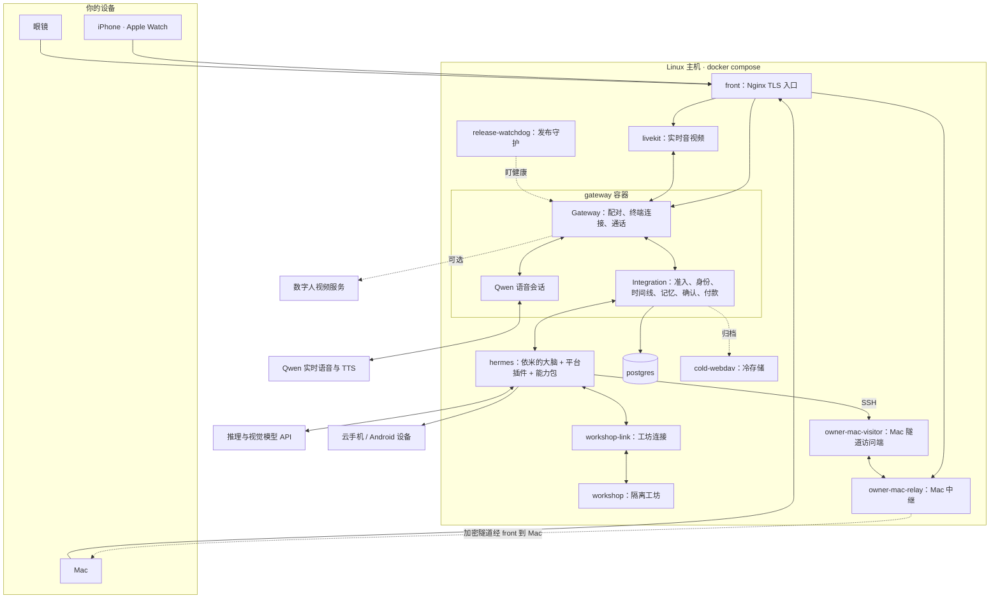

**中文** · [English](README.en.md)

# 依米 · Personal AI OS (Personal Agent) 0.1.5

让每个人都有自己的依米。

依米是一个私人助理，像只属于你一个人的贾维斯。她住在你的手机、眼镜、手表和 Mac 里，跟你说话、听你吩咐，记得你说过的事和你的习惯，通过你授权接入的数据了解你的日程、位置和身边的人。你说一句“帮我点份和上次一样的午饭”，她去查、去办，默认办到付款前停下来等你点头。她不会的事，会自己去找现成的工具学，找不到就自己做一个，试好了再用。

她跑在你自己部署的服务器上，用你选择的模型，按你的授权使用接入的数据和设备。模型可以通过配置切换，你和她之间积累的记忆不随模型切换而清空。

再往远一点看：如果每个人都有自己的助理，助理之间就可以在各自使用者允许的范围内直接商量，比如约一顿饭、对一下时间、分一笔账。到那时，办一件事不必再打开一个又一个 App 或平台。这是我们想走的方向；0.1.5 还没有完整的 A2A 接入。

项目始于 2026 年 10 月，采用 Apache-2.0 许可。

## 0.1.5 的更新

- **本地模型。** 配置本地模型目录后，可以在设置里切换语音识别、语音活动检测、声纹、唤醒词和向量模型，切换前要在设备上签名确认；设置页会显示选中的版本、实际生效的版本、上一个版本、进度和错误。部署者要配置 `local_catalog_file`，并预先准备模型文件、绝对路径和可信摘要；这个入口不下载模型。换语音模型后要重启服务；换声纹模型还要为所用的采集通道重新录入并校准。向量模型要自备运行环境，等派生索引重建完才切换。人脸模型只在目录里展示，切换要走人脸录入流程。
- **声纹。** 声纹核验线按采集通道分别持久保存，只升不降，最低 0.65。自动逐步上调需要同一通道有足够的确认样本；重启或在配置里调低，都不会降低已保存的值。
- **说话偏好。** 依米可以在平台偏好区里选择预设的语气、表达和习惯，最多 1,500 字符，可以恢复上一版。平台负责保存版本，并投影成只读的 `memories/PERSONALITY.md`；偏好不能用来修改身份、锁定的人格或受保护的规则。
- **可选会议助手（端到端进行中）。** 本版提供可选的 `meeting-assistant` 服务端编排和演示文稿协议，覆盖页面读取、按讨论定位文字、修改预览、首次修改确认和结果不明时的核查。真正读写 Keynote，还需要一个实现该协议、并能返回修改回读证据的 Mac 执行端；随附的 Mac 源码尚未实现这些工具，所以只启用能力包还用不起来。接通执行端，还要配置平台端口和内部服务凭据、授权本地文件，并连上指定的 Mac 和一副眼镜。协议只允许替换文字和追加段落；默认部署不启用这个包。

## 0.0.2 的基础

以下是 0.0.2 引入、在当前版本中保留的基础能力。

0.0.2 把依米会做的事整理成统一的“能力包”：每项本事怎么接进来、怎么交回结果、出了问题怎么单独退回，都按同一套规矩。这样她学新本事更顺手，你也更容易看清她做了什么。

- **能力包。** 米家、手机任务、消息、微信、桌面、Mac 和内置工具，都以能力包的形式接入。每个包可以单独启用和回退（单机外设还需启用对应开关）；涉及确认的动作走同一套确认合同，执行结果按同一份回执合同交回。能力包是本项目在 Hermes 之上加的一层，不是对上游 Hermes 的改动。
- **工坊。** 工坊负责查找、构建和自测能力包；平台能力包注册表负责登记检查、发布、监控和按包回退。
- **模型设置。** 模型设置只有一个权威来源。单机部署第一次启动时，从 `.env` 导入主脑、视觉和工坊的模型配置；之后的启动沿用已保存的设置和凭据，详见下文“部署”。
- **用量记录。** 模型用量分开记录输入、输出、缓存读取和缓存写入；用量或费用无法确认时，保留估算或未知标记。
- **记忆。** 新版本启动时，会把 Hermes 原生核心记忆里已有的条目导入个人记忆。正式发布流程回退到旧版本时，旧版本读到的是当前核心记忆资料的投影；之后重新升级，只导入回退期间新增的条目。
- **客户端。** 手机、手表和 Mac 的连接、音频和界面都有更新，仍以源码交付；第三方 SDK 和模型资源需要另行取得。
- **贡献文档。** 保留了社区贡献的 Mac 桌面模拟器指南，以及原生端测试的环境前置说明。

## 一句话之后发生了什么

拿一个例子走一遍：你戴着眼镜说“依米，把今天会上那份资料整理一下，发给小林”（小林是虚构的联系人）。

1. **唤醒和听写。** 眼镜在本地用 Sherpa 关键词模型听到“依米”，把语音送到服务器。在这条输入通路上，Qwen 实时语音前端只做转写、提取候选，既不回答，也不执行；通话时朗读回复的是另一个语音会话。
2. **准入和身份。** Gateway 收下这条输入，交给 Integration。Integration 用声纹核对说话人，确认是你之后，把这句话写进你的个人时间线。手机和 Mac 可以同步查看这条时间线。
3. **思考和分工。** 依米的“大脑”是一个 [Hermes Agent](https://github.com/NousResearch/hermes-agent) 实例，加载了本项目的 `personal_aios` 平台插件和 `yimi_gateway` 能力门禁插件。当前仍带锁定的临时残余补丁，补丁归零进行中；配置了委派工具集的根代理通过补丁里的白名单保留对话类工具。主代理负责跟你说话、做判断、读取交谈所需的记忆和管理委派：她先回你一句“好，我去整理”，再把整理和发送交给后台子代理去做。
4. **动手。** 子代理调用工具，查记忆、读文件、写摘要。
5. **首次发送确认。** 要发给小林时，服务器先查有没有先例：同一个你、同一个收件人、同一类任务，第一次发送要你确认，你会收到一张确认卡。确认过一次，以后同样的事不再问；换了人或换了任务类型，会重新问。
6. **回报结果。** 依米应当拿到真实的执行结果后才说“发好了”。这句回复写回时间线，同步到你的手机和 Mac。

换成点外卖，第 4 步会交给手机执行器：它在一台云手机（或你接入的 Android 设备）上打开 App，一步步点下去。走到收银台时执行器会停下，改由付款流程接手，见下面的“安全约定”。

## 她怎样学会新本事

- **技能。** 技能就是一份 `SKILL.md`，教她怎样组合已有的工具办成一件事。仓库里自带外卖、打车、云手机、米家、Mac 桌面、记忆回顾等技能（`integrations/hermes/personal_aios/errands/` 和 `capability/packages/*/skills/`）。
- **工坊。** 遇到没有现成工具的事，她在隔离的工坊容器里找、写、测试新技能，测试通过后才发布；发布过的技能可以撤回。工坊跑在单独的容器和网络里，构建时用一份独立的 Hermes 配置，不挂载日常对话和记忆的数据卷；仍可读工坊快照、配置与桌面输入。新工具按能力包的格式来做，见 [给依米增加能力](docs/skills-and-connectors.md)。
- **修自己。** 你跟她说“哪里不好用”，她能改的（说法、习惯、技能）当场改。产品代码的问题，她可以交给独立的构建服务去修。修好的版本先在预发环境跑完回归，再挑空闲时上线；你说一句“改回去”，就回到上一个版本。这条路需要部署者另外配置构建服务、隔离预发、候选源码仓库、发布 runner、凭据及快照回滚。首次单机入口关闭自动自修复发布，见 [首次运行指南](docs/first-run.md)。

## 0.1.5 里有什么

| 部分 | 交付形式 | 说明 |
| --- | --- | --- |
| Linux 服务端 | 源码 + Docker Compose | 部署者在自己的主机上构建镜像，本版本不提供预构建镜像。 |
| iPhone、Apple Watch、Mac | 源码 + [构建说明](docs/clients.md) | 阿里云 ARTC SDK、唤醒词模型等供应商资源需要按说明另行获取。 |
| 眼镜（Android，RayNeo X 系列） | 源码 + [构建说明](docs/clients.md) | RayNeo SDK 需另行获取；本版本提供源码构建说明。 |
| 模型 | 配置 | 每个角色单独配置服务商和模型，见下文。 |

各设备分工：

- **手机**：文字、语音、通话、设备配对、记忆和健康查看，以及付款确认卡。
- **眼镜**：语音唤醒、第一视角拍照、HUD 卡片、点头摇头作答，语音付款（需开启）。
- **手表**：在手表上跟她说话、看通知、骑行和运动记录。
- **Mac**：桌面对话、共享屏幕；配对后，依米可以经加密中继在这台 Mac 上读写文件、执行命令、操作应用。你可以用快捷键随时暂停她操作电脑，执行过的命令都留有记录。
- **家里**：米家设备通过独立的 MCP 服务接入。

## 系统架构



主要服务定义在 `deploy/cloud/compose.yaml`，冷存储定义在其引用的 `compose.archive.yaml`。主要服务分成 `production` 和 `staging` 两个 profile，预发和正式版用同一份应用镜像，但数据和外部执行配置隔离。单机入口叠加 `compose.single-host.yaml`，默认启动七个核心服务；图中的其他服务按需开启。几个要点：

- 对外只开一个 TLS 端口（单机入口默认 8443）和 WebRTC/TURN 端口，都在 `front` 上。
- Gateway、Integration 和 Qwen 语音会话在同一个容器里，进程入口是 `rayneo-persistent-production-entrypoint.ts`。
- `hermes` 容器里除了 Hermes 本身，还通过能力包加载 MCP 服务；手机执行器（基于 Mobilerun）、米家服务和 Mac 连接按配置启用。
- `workshop` 在单独的 Docker 网络里，只读根文件系统，内存和进程数有上限，只能经 `workshop-link` 被访问。
- 服务器本地跑语音识别、声纹（Sherpa）和人脸识别（OpenCV）模型；完成归档的数据会打包上传冷存储（OpenList WebDAV），本地副本默认保留两天；空间紧张时会先发出通知，再提前清理已校验的本地副本。

更细的模块地图和阅读顺序见 [架构导览](docs/architecture.zh-CN.md)。

## 模型是配置

依米不绑定某一家模型。每个角色单独配置，密钥不进源码，也不进镜像：部署用的密钥放在密钥目录里，以只读文件挂到容器的 `/run/secrets/`；主脑、视觉和工坊的模型服务商密钥在首次启动时导入加密存储。

单机入口通过 `deploy/cloud/.env` 配置七个角色。只有 brain 必填，示例使用 DeepSeek 官方 API，也可改为其他 OpenAI-compatible Chat Completions 服务；vision、executor fast、executor thorough、realtime、TTS 和 workshop repair 默认关闭。工坊未单独配置 repair 角色时使用已配置的 brain。其中 brain、vision 和工坊三项的模型设置只在首次启动时从 `.env` 导入，此后以已保存的设置为准，要改就到客户端的“模型与密钥”页面；手机执行器、realtime 和 TTS 仍读取各自的只读部署配置。下表列出底层服务配置；单机入口的角色配置、协议和前置条件见 [首次运行指南](docs/first-run.md#模型角色)。

| 角色 | 配置位置 | 默认 |
| --- | --- | --- |
| 主对话、后台子代理 | 模型设置权威的 `brain`、`delegation` 角色；Hermes 读取其运行投影 | 按实例设置；导入示例使用 DeepSeek |
| 看图 | 模型设置权威的 `auxiliary.vision` 角色 | 按实例设置；导入示例使用 SiliconFlow GLM，单机入口默认关闭 |
| 实时语音、通话 | `deploy/cloud/cloud.json` 的 `voice_frontend` | Qwen Omni 实时模型 |
| 朗读 | `cloud.json` 的 `tts` | Qwen TTS |
| 手机执行器 | `integrations/connectors/phone_executor/mobilerun-config.example.yaml` | DeepSeek + GLM |

依米的声音来自 Qwen 的语音模型，经阿里云 DashScope 调用，不是本项目训练的。换语音模型或音色时，要同时确认协议和已保存的语音资源仍然匹配。

## 安全约定

- **对外发送：** 同一使用者、同一收件人、同一类任务，第一次发送要你确认，确认记录存在服务器上；换人或换类任务再确认。不是你要求的对外动作，每次都要确认。
- **付款：** 每一笔生成独立授权，旧的授权不能挪用。默认每笔都在手机上点确认卡（手机须解锁，确认带设备签名）。另有两个可选项，默认都关着，金额限额可配置：
  - *声纹付款*，在手机上开启。前提是已登记声纹、满足手机和眼镜的锁定规则、解锁租约有效。之后，对近期从同一终端发起的语音请求，你可以在手机或眼镜上说“付吧”确认。默认只限已知收款方、单笔 200 元以内，且不超过请求预算。
  - *小额免确认*。要求同时满足：已开启声纹付款、近期的语音请求经声纹核过、解锁租约有效、收款方已知、不超过请求预算、默认单笔 50 元和每天 150 元以内，并且近 30 分钟内没有创建过向同一收款方的其他已授权、支付中、已支付或结果未知的付款。满足时留 5 秒撤销时间，然后自动付款。

  条件不满足，就回到手机确认卡。
- **代码门禁的范围：** 能力包工具，包括她自己制作并登记的包，由服务器能力网关按清单检查运行范围、影响类别和所需确认，结果按回执合同核对。自造包不能声明付款或系统变更能力。这个边界是能力调用；不能据此声称任意终端脚本的每个系统调用都被同一网关拦截。
- **密钥：** 不写进源码和镜像。部署密钥以文件挂载；首次导入的模型服务商密钥加密保存，模型设置的主密钥只挂载到 Gateway。
- **费用和数据：** 模型、云手机和数字人服务会产生费用，也会收到完成任务所需的内容。请在服务商那边设好预算，按你的数据要求选择服务商。不要公开配对数据、会话、健康资料、媒体、授权记录或运行目录。

## 部署

单机主机需要 Linux、Docker Engine、Buildx 和 Docker Compose 2.36 或更新版本。启动命令要在部署主机上以 root 身份执行，并能访问 Docker daemon。工坊准备器会给工坊分配一块独立的 1 GiB ext4 容量卷并配置挂载，所以主机上还要有 Python 3、e2fsprogs、util-linux 和 systemd。完整要求、端口、配对和文字往返步骤见 [首次运行指南](docs/first-run.md)。在仓库根目录以 root 执行：

```sh
cp deploy/cloud/.env.example deploy/cloud/.env
chmod 600 deploy/cloud/.env
# 编辑 .env，填写 PAIOS_BRAIN_API_KEY，并按需配置自己的 host/IP。
sh deploy/cloud/build.sh --up
```

该命令从公开源码构建镜像，生成缺少的内部凭据和默认自签 TLS，运行迁移并创建实例身份，再启动七个核心服务。默认支持文字对话；语音、外设、冷存储和数字人需要按指南另行配置。已有凭据和证书会保留。`prepare-build.py` 准备构建输入，`hermes-init.py` 把配置的模型、技能目录和 MCP 服务写进 Hermes 配置。

`.env` 里的模型配置只在第一次启动时导入：主脑、视觉和工坊的设置连同服务商密钥一起进入模型设置的权威存储。之后的启动沿用已保存的设置和凭据，再改 `.env` 不会覆盖它们；要换模型或密钥，请到客户端的“模型与密钥”页面。

上线之后，`release.py` 负责新版本的构建、测试、预发、切换和回滚。每台主机用 `current` 和 `previous` 两个指针标记当前版本和上一个版本；`release-watchdog` 发现已接管的新版本持续不健康或反复重启时，会自动切回上一个版本。回滚恢复镜像和发布文件。为了让旧版本仍能读到你的记忆，正式发布的回退流程会先把当前的核心记忆资料投影给它；之后重新升级，只导入回滚期间新增的条目。普通发布回滚不撤销数据库迁移、客户端更新或已经发生的外部操作；若该版本执行过历史隔离，回滚会先恢复与它绑定、已完成且未过期的隔离历史，或继续尚未完成的恢复流程，并保留当前设置等保留项，所以部署前请备份数据（模型设置的权威存储要和它的主密钥一起备份、一起恢复），并在隔离环境里试过恢复。

## 源码在哪

| 目录 | 内容 |
| --- | --- |
| `01-product-half-finished/backend/phase0/gateway` | 设备接入、配对、实时通话 |
| `01-product-half-finished/backend/services/personal-aios-integration` | 准入、身份、时间线、记忆、确认、付款 |
| `capability` | 能力包、合同、回执 SDK 与模板 |
| `integrations/hermes/personal_aios` | Hermes 平台适配、人设、技能与工坊 |
| `integrations/connectors/phone_executor` | 手机执行器和收银台检查 |
| `01-product-half-finished/apple/current-mac-source-20260930/clients/phase0/apple-native` | iPhone、手表、Mac 客户端 |
| `01-product-half-finished/glasses-android` | 眼镜客户端 |
| `deploy/cloud` | 容器、配置生成、发布和数据快照工具 |

## 参与

先读 [参与贡献](CONTRIBUTING.zh-CN.md) 和 [测试说明](docs/testing.md)。公开 CI 不需要模型密钥，公开 CI 中的模型调用用本地桩。使用 Node 24.19.0 和 pnpm 11.9.0，从仓库根目录先跑一个小测试：

```sh
cd 01-product-half-finished/backend/phase0/gateway
pnpm install --frozen-lockfile
node --test tests/activity-update-contract.test.ts
```

这只验证共享协议。通话、设备权限、外部执行和恢复，还需要在你自己的主机和设备上验证。安全问题请走 [私密报告渠道](SECURITY.md)。

## 许可

除单个文件和 [NOTICE](NOTICE) 另有说明的部分外，代码采用 [Apache License 2.0](LICENSE)。米家 MCP 服务 `capability/packages/mijia/server/mijia.py` 采用 GPL-3.0-or-later，作为独立进程运行。默认头像是 AI 生成的虚构人物，见 NOTICE。其他第三方依赖、模型、SDK 和素材遵循各自的许可证。

## 详细说明

想深入了解依米，可以按下面三份文档的顺序读。三份文档写的是同一套系统：技术方案讲结构，整套流程讲每件事怎么一步步走完，技术报告讲为什么这样做、效果如何。三份全文都收在下面，点开即可阅读；单独的文件在 [docs/technical-plan.md](docs/technical-plan.md)、[docs/flows.md](docs/flows.md) 和 [docs/tech-report.md](docs/tech-report.md)。

文中标「进行中」的能力尚未上线；其余机制以 0.1.5 公开代码为准，历史数字另标为早期测量。

<details><summary><b>技术方案</b></summary>

## 依米技术方案

这份文档讲依米作为一个整体是怎样搭起来的：哪些部分是内核，哪些是平台，能力怎样接进来，每一个动作要过哪道门，结果怎样被如实说出来。端到端的流程见 [流程说明](docs/flows.md)，机制细节和实测数字见 [技术报告](docs/tech-report.md)。

### 0 为什么是这样一套系统

我们想要的未来是：每个人都有一个只属于自己的助手。她认识你，记得你说过的事，能替你用手机上的每个 App、家里的每台设备、电脑上的每个文件，并且和你住在一起，从早到晚。等每个人都有了这样的助手，很多事就不必再经过平台：你的助手和对方的助手直接商量，你们只在最后点头。

要走到那一步，这个助手先得是一个完整、独立、属于用户自己的系统。依米因此有三个大前提：

1. **一人一套，装在用户自己的云主机上。** 整套系统以容器形式运行在满足部署要求的 Linux 主机上，部署者只需要配置模型 API，并准备数据库、密钥、TLS 与所需外部服务。
2. **模型是配置。** 每个角色单独选服务商和模型，换模型不清空记忆。
3. **她会自己学习、自己制造和使用工具。** 缺能力时先找现成的，找不到就自己做，试好了再用。

### 1 设计原则

| 原则 | 意思 | 落在哪里 |
|---|---|---|
| 内核是内核 | 以上游内核为基础，残余补丁归零进行中 | 能力包与记忆的三项接入（第 2 节）；仍有临时补丁和部分原有接入 |
| 一件事只有一个权威 | 每个事实只有一处说了算，其余只读或只存快照 | 平台服务（第 3 节） |
| 能力只有一种格式 | 已迁移的能力和依米自造的能力采用同一种能力包 | Agent Plugins v1 + 扩展区（第 4 节） |
| 分类固定 | 新能力只对号入座，不为它补代码 | 9 类影响、6 类事实（第 5、6 节） |
| 事实由系统说 | 状态和数字来自回执，模型只负责内容和语气 | 事实句 + 确定性校验（第 6 节） |
| 安全靠隔离、可回滚和首次确认，不靠拒绝 | 读取只查范围；对外影响首次确认；付款逐次确认 | 门与回退（第 5、10、12 节） |
| 云上原样运行 | 产品路径上没有某台个人电脑专用的机制 | 容器部署（第 11 节） |

下文以 0.1.5 公开代码为准。标「进行中」的端到端能力还没有完成上线：代码接上了，不等于已经在生产上验收。

### 2 总体结构


*图 1｜依米的整体结构。*

系统分三层，外加设备和外部服务：

- **平台服务**（TypeScript，运行在 `gateway` 容器里）：所有产品规矩和事实的唯一权威。
- **内核**（`hermes` 容器）：上游 Hermes Agent，加三件接入件。
- **能力包**：已迁移能力的统一格式，由内核按需加载，经平台的能力网关判定和记账。

#### 2.1 内核与三件接入件

Hermes 锁定在上游 v0.22.5 的提交 `bf0203a`（`integrations/hermes/personal_aios/producer.lock.json`）。目前它还带着一份临时的残余补丁。能力包和记忆主要靠下面三件接入件和平台相连：

| 接入件 | 做什么 | 位置 |
|---|---|---|
| 薄插件 `yimi-gateway` | 注册三个工具钩子 `pre_tool_call`、`transform_tool_result`、`post_tool_call` 和九个生命周期钩子；判定交给平台，结果换成回执；133 行 | `integrations/hermes/yimi_gateway/` |
| 记忆接入 `personal_aios` | 上游 `MemoryProvider`；每轮把平台生成的核心档案带进上下文；原生记忆写入关闭 | `integrations/hermes/personal_aios/__init__.py` |
| 能力包加载 | 部署时校验每个包的 `plugin.json`，按配置和开关生成 Hermes 的 MCP 服务配置和技能目录 | `capability/packages/load.py`、`deploy/cloud/hermes-init.py` |

过渡期还有一份标为临时（`TEMPORARY`）的残余补丁 `native-context.patch`。它里面仍有运行范围、主代理分工这类产品逻辑，目标是归零（进行中）。另外，`personal_aios` 还保留着一部分工具和中间件的注册。

#### 2.2 主代理只交谈，事交给子代理

主代理负责交谈、判断、读取对话所需的记忆、交代目标。凡是要动手的事，哪怕只用一个工具，也交给原生异步子代理。

这条分工由残余补丁实现，而不是薄插件：补丁中的 `CONVERSATION_TOOLS` 和 `restrict_agent` 让配置了委派工具集的根代理只保留对话类白名单，执行类工具对它不可见。一次运行的整棵委派树共用一份工具调用预算（生产配置 120 次）；同时最多 3 个子代理，派生深度最多 2 层。

### 3 平台服务：唯一权威

| 权威 | 管什么 | 主要位置（`personal-aios-integration/src/`） |
|---|---|---|
| 身份与入场 | 设备配对；声纹判定；每一轮的运行范围：用户本人 `owner`、身份未确认 `owner_uncertain`、访客 `guest`，另有构建 `build` 与关怀 `care` | `admission.ts`、`owner-authority.ts`、`voiceprint/` |
| 同意与付款 | 首次发送与逐次确认；付款意图、授权、收银台核对 | `effect-consent.ts`、`capability/consent/`、`payment/` |
| 时间线与记忆 | L2–L5 记忆；带序号、可分页同步的时间线 | `memory/`、`timeline.ts`、`archive.ts` |
| 投递 | 回复分块下发到目标设备；按设备的 ACK | `output.ts`、`routing.ts` |
| 语音 | Qwen 实时语音会话与朗读 | `tts.ts`、`voice/`，网关侧 `phase0/gateway/` |
| 活动卡 | 后台任务的卡片，状态直接取自回执 | `activity.ts` |
| **能力网关** | 调用判定、回执账本、事实句、确定性校验 | `capability/gateway.ts`、`ledger.ts`、`renderer.ts`、`checker.ts` |
| 能力包注册表 | 依米自造包的登记检查、发布、监控和按包回退 | `capability/registry/` |

账本和回执只管两件事：工具返回了什么，已经对用户说过什么。其他事实各有归属：任务状态归执行端，同意归 `effect-consent`，付款授权归付款流程，记忆归平台记忆。账本不存第二份。

#### 3.1 能力网关

网关有三个本机回环接口，对应薄插件的三个钩子：

- **decide**：判定一次调用。它按入场记录绑定用户、运行和范围；注入会话、运行、调用编号、幂等键等可信字段，覆盖模型给出的同名参数；读取 `owner_requested`，执行前由适配层过滤；按清单解析影响类别；拦下已成功且不许重试的重复调用，也拦下未经核查就重试的不明调用；只读和工作区放行，其余交给同意、付款或发布权威。结果只有四种：放行、改参、拦下、请确认。
- **receipt**：在信任边界上校验回执，执行五条不变式，按（任务编号，调用编号）幂等落账，只把尚未送达的事实渲染给模型。
- **observe**：只记录耗时与错误，不改变已入账的回执。

网关不可达时，薄插件绝不默认算成功：执行前，能力包工具一律拦下（「本次未执行」）；执行后，向模型返回「结果尚未核实」。

### 4 能力包

#### 4.1 一个包长什么样

```text
mijia/
├── plugin.json                 ← 标准清单 + extensions."ai.yimi.capability"
├── mcp.json                    ← MCP 入口（stdio 或 HTTP）
├── skills/mijia/SKILL.md       ← 何时用、怎么用
├── server/                     ← 包自己的代码
├── fake/                       ← 假实现：工具名和回执与真实实现一致
└── tests/contract.yaml         ← 合同测试：输入 → 期望的回执
```

#### 4.2 清单的扩展字段

扩展区 `extensions["ai.yimi.capability"]` 由 `capability/contracts/manifest.v1.schema.json` 校验，必填字段如下：

| 字段 | 内容 |
|---|---|
| `schema`、`receipt_schema` | 扩展版本、回执版本（整数） |
| `compat` | 兼容的 Hermes 版本范围与网关接口版本 |
| `maintainer` | `lead`（平台维护）或 `yimi`（依米自造） |
| `runtime` | MCP 服务名；`lazy`（懒启动）；`idle_timeout_seconds`（空闲回收）；`host`：`shared` 或 `dedicated` |
| `secrets` | 只写密钥的名字，值由平台注入 |
| `network.egress` | 出网白名单（声明；执行靠容器网络策略） |
| `scopes` | 哪些运行范围看得到本包：`owner`、`owner_uncertain`、`guest`、`build`、`care` |
| `tools` | 每个工具恰好声明 `effect` 或 `effect_by_arg` 之一；可选 `target`、`task_type`、`retry`、`check_with`、`context_inject`、`long_running` |
| `staging.fake` | 假实现的启动命令 |
| `tests.contract` | 合同测试文件 |
| `provenance` | 来源提交、构建记录、适配模块清单 |

`maintainer` 为 `yimi` 的包不得声明 `spend` 或 `self_change`，包括 `effect_by_arg` 的任一分支，Schema 直接拒绝。

#### 4.3 当前的包

基础部署配置 `deploy/cloud/cloud.json` 列出了 14 个包和依米自造包的入口 `yimi`：

| 包 | 工具数 | 用到的影响类别 | 运行方式 |
|---|---:|---|---|
| phone（手机跑腿） | 8 | observe、owner_data、workspace；按参数：send、account、physical、spend、delete | 独占进程 |
| mijia（米家） | 6 | observe、physical、account | 独占进程 |
| owner-mac（Mac 远程操作） | 6 | observe、owner_data | 独占进程 |
| messaging（发消息） | 2 | observe；按参数：send | 共享 Python 宿主 |
| wechat-mac（Mac 微信） | 4 | observe、send | 共享 Python 宿主 |
| desktop（Mac 桌面助手） | 16 | observe、owner_data | 平台 TS 服务（HTTP） |
| ts-delivery / ts-erasure / ts-health / ts-location / ts-memory / ts-model-settings / ts-personal / ts-schedule | 3 / 3 / 1 / 5 / 9 / 2 / 5 / 2 | 各自声明，如记忆写入为 owner_data、遗忘为 delete | 平台 TS 服务（HTTP） |

小包共用一个宿主进程 `yimi_shared`，用到时才启动，空闲 900 秒回收；有长驻状态或重依赖的包独占进程。自造包切换时，共享宿主发出 `tools/list_changed`，Hermes 刷新工具列表，不需要重启。米家、Mac 微信和两个 Mac 包在单机部署里各由一个开关控制。

工具多了以后可以用上游的 Tool Search 按需加载。早期在隔离环境里、几十个工具的规模上测过：开启后选对率不变，但更慢（按所列均值计算，平均耗时约 +22%；token −34%），所以目前关闭。

### 5 影响类别与门


*图 2｜九类影响与对应的门。门的规则没有改，只换了触发方式：由清单声明，而不是由模型每次自报。*

几条细则：

- **读取只查角色范围。** 用户没开口，她也可以读，比如读手机 App 里的内容。
- **「是否明确要求」由模型判断。** 判断结果作为保留参数 `owner_requested` 交给网关；执行适配层会把它过滤掉，不传给底层业务调用。
- **未经明确要求的动作要确认**：`required = sending || !requested`。只有「用户明确要求的发送」会被记住，范围是同一用户、同一收件人、同一任务类型；换人或换类任务再问。
- **云手机的启动、关闭和停止任务算工作区**，不弹卡；保存和恢复用户的 App 登录数据按「改用户的东西」走门。
- **定时任务里需要确认的动作直接拦下**，不在没人的时候弹卡。

### 6 回执与汇报


*图 3｜回执的六类事实与信任边界上的五条不变式。*

同一份事实有三个出口：

1. **活动卡**：状态直接取自回执，包括 `unknown` 和 `waiting`。
2. **文字和语音**：事实句由平台按事实类别的固定模板生成（语音版更短）；内容句由模型写，负责判断、建议和语气。目前按事实标识去重后输出；限制投影条数、单条长度和数组摘要，留待后续版本。
3. **确定性校验**：零模型调用，在出口前核对数字、单位、状态词、「已记下」的凭据和重复，不一致的句子删去，缺的事实用模板句补上。

「新旧差异」以真正送达为准：只有设备回了有效 ACK（文字 `rendered`、语音 `played`），且 ACK 覆盖的回复确实带着这条事实，它才算「说过了」。

### 7 设备与分工

| 设备 | 做什么 |
|---|---|
| iPhone | 文字、语音、通话；本地唤醒词「依米」；Face ID 用于应用锁、付款、改设置和「接下来 1 分钟是我在说」；付款确认卡；声纹、健康、位置、通讯录、模型设置；暂停 Mac 操作 |
| Apple Watch | 在手表上说话、看卡片和通知、骑行与运动记录；经手机中继 |
| Mac | 桌面对话、共享屏幕；配对后经加密中继让依米读写文件、执行命令、操作应用；快捷键随时暂停；命令记录可查；Touch ID 确认；Mac 微信 |
| 眼镜（Android，RayNeo X3 Pro） | 本地唤醒词；第一视角画面；HUD 卡片；点头确认、摇头关闭（骑行时关闭手势）；语音付款（需开启） |

所有设备共用一条时间线：回复发往发起这句话的设备（手表经手机中继），其他设备按序号拉取同一条记录。换设备不用重新开始。

### 8 语音：快思考与慢思考

- **前台（快思考）**：Qwen 实时语音模型（默认 `qwen3.8-omni-flash-realtime`），负责听和说；闲聊和简单常识当场回答，公开信息先查证；需要记忆、私人记录、操作或深入推理时，调用 `handoff_to_brain` 交给主脑，带 `difficulty`、`intent`、`thinking` 三个字段。
- **主脑（慢思考）**：Hermes 主代理，按 `thinking` 开关本轮推理；执行交给后台子代理，结果回来后转述。
- **朗读**：Qwen TTS（默认 `qwen-audio-3.0-tts-plus`）。依米的声音来自 Qwen 的语音模型，经阿里云 DashScope 调用。
- **服务器本地模型**：语音活动检测、识别、声纹、唤醒词和人脸识别用本地 ONNX 模型。

声纹按采集通道分别登记，默认起始判定线为 0.65 / 0.45。Face ID 或 Touch ID 打开一个 60 秒的信任窗口，为一通电话作保；通话内的锚点用来认短句。声纹核验线按采集通道分别持久保存，只升不降，最低 0.65。自动逐步上调需要同一通道有足够的确认样本；重启或在配置里调低，都不会降低已保存的值。

### 9 记忆 L1–L5

| 层 | 内容 | 权威 |
|---|---|---|
| L1 | 当前对话与压缩后的上下文 | Hermes 原生 |
| L2 | 核心档案 `USER.md`、`MEMORY.md` | 由平台从 L3 生成，只读 |
| L3 | 带版本和依赖的结构化断言 | 平台（PostgreSQL） |
| L4 | 时间线与会话历史 | 平台时间线；会话历史由 Hermes 原生保存 |
| L5 | 原始音频、画面和事件 | 平台：本地热存储 + WebDAV 冷包 |

- **写入**：后台子代理读过证据，用 `paios_l3_commit` 提交断言（影响类别 `owner_data`），带预期版本做比较交换。上游一变，下游结论就标记为待重评。
- **遗忘**：`paios_l3_forget`（`delete`）沿依赖递归，删除全部版本的载荷，留下遗忘标记。
- **读取**：主代理按问题挑层。通话场景另有一份短上下文：六路并行，每路 1,200 ms，合计 2,400 字符。

L5 的处理和存储设有预算：归档小批、磁盘准入（4 GiB + 500,000 inode）、分析队列上限、通话时让路、冷包无损压缩、上传启动间隔控制与两次校验后才删热副本；热副本默认保留 2 天，可配置。见技术报告 3.5 节。

### 10 同意与付款

- **首次发送确认**：同一用户、同一收件人、同一任务类型，第一次发送要确认。
- **不阻塞的确认**：需要确认的动作立即返回一张「在等你确认」的回执，子代理继续办别的。用户批准后，平台复核、只执行一次，再新起一轮汇报结果。
- **付款**：每一笔独立授权，永不记住。默认在手机上点确认卡（手机须解锁，确认带设备签名），授权 60 秒内有效。执行器点付款前回读收银台金额，和授权不等就换新卡，每个意图默认最多换 2 次。
- **可选项（默认关）**：声纹付款，在手机或眼镜上说「付吧」，默认单笔 200 元以内、收款方须已付过款；小额免确认，单笔 50 元、每天 150 元以内，30 分钟内没有向同一收款方创建过其他已授权、支付中、已支付或结果未知的付款，留 5 秒撤销。
- **叫车**：需要用户来源的叫车许可；测试环境禁止真叫车。米家的门锁类设备只读。

### 11 云上部署


*图 4｜一台 Linux 主机上的容器。*

- 服务定义在 `deploy/cloud/compose.yaml`，冷存储在 `compose.archive.yaml`。`production` 与 `staging` 两个 profile 用同一份镜像，数据卷各自独立；预发配置把手机和米家换成本地替身。内核自修复的完整预发回归仍在进行中。
- 对外只有 `front` 一个 TLS 入口（基础 Compose 默认 9443，单机入口默认 8443）和 WebRTC/TURN 端口。
- `workshop` 在独立的 Docker 网络里：只读根文件系统，内存 256 MiB，0.5 个 CPU，最多 128 个进程，管理入口经 `workshop-link` 访问，出网另受工坊策略约束。
- 部署密钥以只读文件挂到 `/run/secrets/`，不进源码、不进镜像；模型服务商密钥由模型设置权威加密保存，能力包清单里只有密钥的名字。
- 单机入口默认启动 7 个服务：gateway、hermes、front、postgres、livekit、workshop、workshop-link。
- 每台主机用 `current` 和 `previous` 两个指针标记当前版本和上一个版本，清理命令只保留这两个版本。`release-watchdog` 发现新版本持续不健康或反复重启时，切回上一个版本。

**模型角色。** 主对话、后台子代理、看图、语音前台、朗读、手机执行器的快慢两档，各自单独配置。示例配置里，主脑和子代理用 DeepSeek，看图用 SiliconFlow 托管的 GLM，手机执行器用 DeepSeek 加 GLM。用户可以在 iPhone 或 Mac 的设置里改日常角色的服务商和模型。改动先存成草稿，经设备生物识别确认后，在当前任务结束时生效（iPhone 用 Face ID，获授权的 Mac 用 Touch ID）。依米只能读取和起草，不能直接改。配置本地模型目录后，可以在设置里切换语音识别、语音活动检测、声纹、唤醒词和向量模型，切换前要在设备上签名确认；设置页会显示选中的版本、实际生效的版本、上一个版本、进度和错误。部署者要配置 `local_catalog_file`，并预先准备模型文件、绝对路径和可信摘要；这个入口不下载模型。换语音模型后要重启服务；换声纹模型还要为所用的采集通道重新录入并校准。向量模型要自备运行环境，等派生索引重建完才切换。人脸模型只在目录里展示，切换要走人脸录入流程。

### 12 云手机执行器

执行手机默认是阿里无影 AgentBay 的云手机。手机包 `phone` 驱动 Mobilerun，由模型一步步读屏幕、决定下一步。一次任务先取得设备租约，再预检、准备，然后进入模型循环：默认 80 步、可请求 1–120 步，模型阶段默认最多 600 s（可配置）。`CheckoutStop` 包住每次点击和输入：没有付款意图时不让进入付款；有付款意图时停在收银台，交给付款流程。超时或取消时，先停工作流、等清理结束，再释放手机。终态原子落盘，回执带任务编号和递增修订号。任务失败、又不是用户取消的，会自动开一次只读自检。

### 13 自我成长

- **自己做工具**：`capability_find` 找现成 → 模板 → 工坊构建 → 登记检查（静态检查 + 沙盒里的影响诚实性检查）→ 发布 → 按包监控与自动回退。依米自造的包不得声明 `spend` 与 `self_change`；不新增上线确认，运行时的门照常生效。
- **自己修自己**：构建工坊复现、找根因、最小修复、补回归测试 → 保护基线问用户一次 → 不可变镜像、7 套断网测试 → 正式机复查 → 空闲切换 → 守护进程。依米改内核时先核对并同步预发与线上，再在预发回归（进行中）。
- **从经历里总结**：Hermes 原生后台复盘把经历写进技能；工坊工具不能直接改，必须走构建和登记流程。

**说话偏好。** 依米可以在平台偏好区里选择预设的语气、表达和习惯，最多 1,500 字符，可以恢复上一版。平台负责保存版本，并投影成只读的 `memories/PERSONALITY.md`；偏好不能用来修改身份、锁定的人格或受保护的规则。

**可选会议助手（端到端进行中）。** 本版提供可选的 `meeting-assistant` 服务端编排和演示文稿协议，覆盖页面读取、按讨论定位文字、修改预览、首次修改确认和结果不明时的核查。真正读写 Keynote，还需要一个实现该协议、并能返回修改回读证据的 Mac 执行端；随附的 Mac 源码尚未实现这些工具，所以只启用能力包还用不起来。接通执行端，还要配置平台端口和内部服务凭据、授权本地文件，并连上指定的 Mac 和一副眼镜。协议只允许替换文字和追加段落；默认部署不启用这个包。

### 14 进行中

| 能力 | 状态 |
|---|---|
| 残余内核补丁归零 | 进行中：当前仍含运行范围与主代理分工等产品逻辑 |
| 依米改内核时先对齐线上、再走预发 | 进行中 |
| 会议助手：按讨论结果读写本地 Keynote | 进行中：服务端编排和协议已有，随附 Mac 源码缺少执行端实现 |
| 助手之间直接商量（A2A） | 进行中：当前公开版本没有完整 A2A 接入；外来代理按访客、向外发送先确认是设计边界 |

</details>

<details><summary><b>整套流程</b></summary>

## 依米的端到端流程

这份文档把依米最重要的七条流程逐条画出来。每条流程都遵守三条约定：

- **每一步只有一个负责方。** 表格里的「负责方」就是这一步的唯一权威，别处只读或只存快照。
- **没有重复路径。** 同一件事只走一条路：能力包调用经能力网关，普通影响确认经同意权威，付款经付款权威，结构化断言写入经平台 L3。
- **失败路径和正常路径画在一起。** 图里红色虚线是失败路径；表格最后一列写清失败时系统做什么。

结构和术语见 [技术方案](docs/technical-plan.md)，机制和数字见 [技术报告](docs/tech-report.md)。

| 编号 | 流程 | 起点 | 终点 |
|---|---|---|---|
| F1 | 一句话到发起设备的回复与多设备同步 | 用户在任一设备上说话或打字 | 回复在设备上显示或播放，并记为已送达 |
| F2 | 一次能力调用 | 子代理决定调用一个工具 | 回执入账，事实交给模型 |
| F3 | 首次确认与付款确认 | 需要确认的动作或付款 | 执行一次，或如实取消 |
| F4 | 依米自己造能力 | 一个愿望或缺失的能力 | 包上线；按包监控、回退 |
| F5 | 内核的自修复与自进化 | 一个 bug 或改进 | 新版本上线，或如实结束 |
| F6 | 平台的发布与回退 | 一个候选版本 | 新版本稳定，或回到上一版 |
| F7 | 记忆：从原始记录到回忆 | 设备上的一次记录 | 一次准确的回忆，或一次 L3 断言遗忘 |

### F1 一句话到发起设备的回复与多设备同步


*图 F1｜一句话到发起设备的回复与多设备同步。*

| 步骤 | 负责方 | 做什么 | 失败时 |
|---|---|---|---|
| 1 唤醒与上传 | 设备 | 眼镜、iPhone、Mac 在本地用 Sherpa 关键词模型听「依米」，再上传语音；或直接发文字 | 未进入唤醒或后续对话窗口，就只是环境观察，不进入请求链路 |
| 2 转写与接入 | Gateway | 校验配对设备身份；非通话输入的 Qwen 实时前端只转写，不回答、不执行 | 设备身份不符，拒绝接入 |
| 3 入场与身份 | Integration（入场） | 声纹按采集通道的已保存核验线判定，定出运行范围；原件写入 L5；这句话写进时间线 | 身份未确认或是访客：只开放该范围的工具，不读私人信息，不办事 |
| 4 发起运行 | Integration → Hermes | `POST /v1/runs`，运行与入场记录绑定 | 运行绑定缺失，后续一切工具调用都被拒绝 |
| 5 首答与委派 | 主代理 | 先说明下一步意图，再用异步委派交给子代理，本轮结束 | 异步池满或会话不支持异步回传：改为同步委派 |
| 6 动手 | 后台子代理 | 能力包工具调用走 F2；原生工具保留各自接入 | 见 F2 |
| 7 结果 | 主代理 | 子代理完成后按回执写结果 | 回执是 `unknown` 就如实说「还不清楚」，并先核查 |
| 8 校验与下发 | 投递（输出） | 确定性校验后分块下发到发起这句话的设备；语音由 Qwen TTS 合成 | 校验不一致的句子删去，换成模板事实句 |
| 9 送达 | 设备 → 投递 | 设备回 ACK：文字 `rendered`，语音 `played`；账本只把 ACK 覆盖的事实记为已说过 | 没有 ACK：事实不算送达，下次跟进仍作为新事实出现 |
| 10 多设备 | 时间线 | 其他设备按序号拉取同一条记录 | 换设备不需要重新开始 |

**通话时**多一层快思考：前台 Qwen 实时语音模型自己回答闲聊和简单常识，需要记忆、私人记录、操作或深入推理时用 `handoff_to_brain` 交给主代理，之后同第 5–9 步。只有用户本人、非访客的回合能交接。

### F2 一次能力调用


*图 F2｜一次能力调用：判定、执行、回执。*

| 步骤 | 负责方 | 做什么 | 失败时 |
|---|---|---|---|
| 1 拦截调用 | 薄插件 `yimi-gateway` | `pre_tool_call` 把工具名、参数、任务与调用编号交给网关 | 网关不可达：能力包工具一律拦下，「本次未执行」 |
| 2 绑定 | 能力网关 | 按入场记录确定用户、运行、范围、调用来源（交互、后台、定时） | 运行已结束或找不到：拒绝 |
| 3 改参 | 能力网关 | 注入可信字段，覆盖模型同名参数；读取 `owner_requested`，执行前由适配层过滤 | 必需的上下文字段不受支持：拒绝 |
| 4 判定 | 能力网关 | 范围 → 重复与不明 → 类别 → 门 | 范围不符、类别无法解析、已成功不许重试、未经核查的重试：拦下并说明原因 |
| 5 门 | 同意 / 付款 / 发布权威 | 只读和工作区直接放行；其余 7 类按表交给各自权威 | 需要确认：转入 F3 |
| 6 执行 | 能力包（MCP 服务） | 按改过的参数执行，返回 `structuredContent` 回执和一段文字 | 包出错：交给第 7 步按不变式归一 |
| 7 入账 | 能力网关 + 回执账本 | 校验 Schema、执行五条不变式；按（任务编号，调用编号）幂等落账 | 不合法回执记 `unknown`；超时、断线记 `unknown` 并要求先查；重放内容不一致返回冲突 |
| 8 交给模型 | 能力网关 | 只渲染尚未送达的事实，连同规范化回执替换工具结果 | 网关不可达：向模型返回「结果尚未核实」，绝不默认算成功 |
| 9 观察 | 能力网关 | `post_tool_call` 只记录耗时和错误 | 观察失败不影响已入账的回执 |

### F3 首次确认与付款确认


*图 F3｜A 段是需要确认的对外动作，确认不阻塞同批其他工具；B 段是付款，每笔独立授权。*

**A 段：需要确认的动作**

| 步骤 | 负责方 | 做什么 | 失败时 |
|---|---|---|---|
| 1 判断要不要确认 | 同意权威 | `required = sending \|\| !requested`；用户明确要求过的同类发送（同一用户、收件人、任务类型）直接放行 | — |
| 2 开卡 | 能力网关 | 开确认卡，写明类别、对象、内容预览和期限；立即给子代理一张 `waiting` 回执 | 在定时任务里：直接拦下，不在没人时弹卡 |
| 3 继续别的事 | 后台子代理 | 同批其他工具照常执行，不被卡住 | — |
| 4 用户应答 | 用户的手机或眼镜 | 批准、拒绝，或超时 | 拒绝或超时：记 `cancelled` 回执 |
| 5 复核与执行 | 能力网关 + 同意权威 | 带确认凭据复核一次；用执行令牌保证只执行一次 | 复核不通过：`cancelled`；执行中断线：`unknown`，要求先查 |
| 6 汇报 | 能力网关 → 主代理 | 结果入账，新起一轮把结果说给用户 | 同一结果只起一次跟进（按事件编号幂等） |

**B 段：付款**

| 步骤 | 负责方 | 做什么 | 失败时 |
|---|---|---|---|
| 1 付款意图 | 付款权威 | 付款意图必须来自用户本人发起的这次请求 | 来源不对：拒绝 |
| 2 停在收银台 | 手机执行器 `CheckoutStop` | 同一设备租约内停在付款前，回读金额、收款方 | 没有付款意图却走到收银台：拒绝这一下，停下汇报 |
| 3 付款卡 | 付款权威 → 手机 | 默认在解锁的手机上确认，带设备签名；可选声纹付款、小额免确认（默认关） | 条件不满足：回到手机确认卡 |
| 4 授权 | 付款权威 | 一次性授权，60 秒内有效 | 过期：作废 |
| 5 点付款 | 手机执行器 + 付款权威 | 点之前再读一次收银台金额，必须与授权相等 | 金额变了：作废旧卡、换新卡，每个意图默认最多 2 次，之后停止 |

### F4 依米自己造能力


*图 F4｜从愿望到上线与回退。*

| 步骤 | 负责方 | 做什么 | 失败时 |
|---|---|---|---|
| 1 交办 | 主代理 | 把愿望交给后台构建任务 | — |
| 2 找现成 | 构建子代理 | `capability_find` 查已安装的包、Hermes 技能市场、官方 MCP 注册表 | 搜索源不可用：照常继续，结果里标明 |
| 3 复用或新建 | 构建子代理 | 有现成的就只写清单和回执包装（≤200 行）；没有就套模板 `yimi-capability-template` | — |
| 4 构建与自测 | 工坊 | 独立网络、只读根文件系统、不挂载日常对话和记忆的数据卷；仍可读工坊快照、配置及桌面输入 | 自测失败：回到构建 |
| 5 静态检查 | 能力包注册表 | 路径与可移植格式、无密钥、清单 Schema、不得声明 `spend`/`self_change`、stdio 入口、必备文件、适配 ≤200 行、体积上限 | 拒绝并返回原因，不回显文件内容 |
| 6 影响诚实性检查 | 能力包注册表（沙盒） | 假实现与真实实现各跑合同用例；只读工具不得写文件；不得创建本地以外的套接字；结果须是合法回执 | 拒绝并返回原因 |
| 7 发布 | 能力包注册表 | 比对线上版本没被改过；预加载、激活、刷新工具列表，不重启 Hermes | 激活失败：尝试恢复原选择，失败则报告错误 |
| 8 运行 | 能力网关 | 包里的对外动作照常过首次发送确认和付款授权 | 见 F2、F3 |
| 9 监控 | 能力包注册表 | 维护周期里做健康检查，并用 Wilson 区间比较新旧版本的「失败 + 未知」率 | 健康失败或明显退步：自动按包回退 |
| 10 改回去 | 用户 → 依米 | 用户说不想要这一版，依米调用 `skills_hub(action="revert")` | 首个版本：移除该包 |

自造包的这条发布流程不走预发，也不新增上线确认；但隔离、登记检查和按包回退一样不能少。

### F5 内核的自修复与自进化


*图 F5｜虚线框为进行中的环节。*

| 步骤 | 负责方 | 做什么 | 失败时 |
|---|---|---|---|
| 1 分流 | 主代理 | 说法、习惯、技能当场改；产品代码或内核交给构建工坊 | — |
| 2 对齐（进行中） | 发布流程 | 核对预发与线上：代码提交、原生代码树、服务镜像、技能、能力包、配置结构、数据快照；不一致先同步 | 同步后仍不一致：停止，不在旧底上改 |
| 3 修复 | 构建工坊 | 复现 → 找根因 → 源头最小修复 → 修前失败、修后通过的回归测试；补丁 ≤1 MiB；首行写成用户能懂的话 | 复现不了或修不好：如实告诉用户 |
| 4 保护基线 | 发布流程 | 检查是否触及付款、真实点击与叫车、首次发送确认、身份、关怀与访客权限、密钥与沙箱、Mac 远程访问、发布与回退，以及人设「最根本的一条」 | 触及：确认卡问用户一次；拒绝就如实结束 |
| 5 构建与测试 | 发布流程 | 不可变镜像；7 套测试断网、只读根文件系统；门槛 $F_{\text{cand}}\setminus F_{\text{base}}=\varnothing$ | 有新增失败，或退出码非零却解析不出失败：拒绝 |
| 6 预发（进行中） | 发布流程 | 用最新快照跑完整系统，对外动作全部被替身拦下 | 回归失败：拒绝 |
| 7 复查 | 正式机 | 基点必须等于线上此刻的提交 | 不等：作废，以线上当前版本为底重修 |
| 8 等空闲 | 正式机 | 无通话、无运行与后台委派、无会话写租约与压缩锁、无手机任务、5 分钟内无故障日志、无内存耗尽 | 不空闲：继续等 |
| 9 切换 | 正式机 | 备份数据库 → 停写 → 切换指针 → 启动 → 核对镜像与健康 | 核对失败：回到上一版 |
| 10 守护与通知 | 守护进程 | 接管新版本；系统消息告诉用户修好了什么 | 见 F6 |

### F6 平台的发布与回退


*图 F6｜发布、自动回退与用户要求的回退。*

| 步骤 | 负责方 | 做什么 | 失败时 |
|---|---|---|---|
| 1 候选 | 发布流程 | 构建不可变镜像，断网测试无新增失败 | 拒绝 |
| 2 复查与等空闲 | 正式机 | 同 F5 第 7、8 步 | 同上 |
| 3 切换 | 正式机 | 备份数据库、停写；`previous ← current`，`current ← 候选`；启动并核对 | 核对失败：回到上一版 |
| 4 守护 | 守护进程（独立于依米） | 记录不健康起点 $t_b$ 和窗口 $W$ 内的重启次数 $R_W$；持续健康就通知用户 | $t-t_b\ge U$ 或 $R_W\ge L$：先写回退意图，再切回上一版，只尝试一次 |
| 5 让位 | 守护进程 | 出现第三个镜像，说明更新的发布已接管 | 本次停止回退，不覆盖新发布 |
| 6 用户要求回退 | 依米 → 正式机 | `skills_hub(action="release_rollback")`，用户原话作为理由；下一个空闲时刻切回 | 当前运行的不是最近一次切换上来的版本：拒绝并说明原因 |
| 7 清理 | 正式机 | 清理命令只保留 current 和 previous 两个版本 | — |

有两条边界。第一，回退只换程序和配置，不恢复数据库，也不撤回已经发生的外部动作。第二，$U$、$W$、$L$ 没有内置缺省值，必须按实测的切换与健康检查时长来配置。

### F7 记忆：从原始记录到回忆


*图 F7｜记忆从原件到回忆，以及遗忘。*

| 步骤 | 负责方 | 做什么 | 失败时 |
|---|---|---|---|
| 1 原件 | 平台记忆（L5） | 设备事件按原样落盘；音频先过磁盘准入（4 GiB + 500,000 inode） | 准入不够：回收后再查，仍不够就如实报「未落盘」 |
| 2 时间线 | 平台记忆（L4） | 每句话带序号写进时间线，各设备分页同步 | — |
| 3 断言 | 后台子代理 → 平台记忆（L3） | 读证据后用 `paios_l3_commit` 提交，带预期版本做比较交换；写依赖 | 版本不等：冲突，重读再决定；已遗忘的编号：拒绝 |
| 4 失效 | 平台记忆（L3） | 上游一改，下游当前结论标记 `needs_reevaluation`，不取反 | — |
| 5 核心档案 | 平台记忆（L2） | 从 `core_profile.entry` 断言生成 `USER.md`、`MEMORY.md`，只读 | — |
| 6 每轮带入 | 记忆接入 `personal_aios` | Hermes 每轮预取核心档案 | — |
| 7 按需回忆 | 后台子代理 | 按问题挑层：L3 查询、L5 原件、画面回忆（RRF，每路最多 100 项） | 原件已删除：跳过，不往后补 |
| 8 通话短上下文 | 平台 | 六路并行，每路最多 1,200 ms，合计 2,400 字符 | 某一路超时：只用其余几路 |
| 9 遗忘 | 平台 L3 记忆 | `paios_l3_forget` 沿依赖递归，删全部版本载荷，留遗忘标记 | L3 载荷没删全：报错；不据此宣称已删 L4、L5 或备份 |
| 10 冷存储 | 平台记忆（L5） | 无损冷包，上传后与删热副本前各校验一次 | 校验失败：告警，该包的热副本一个不删 |

</details>

<details><summary><b>技术报告</b></summary>

## 全天候的、自我成长的助手：依米技术报告

2026 年 10 月

设想几年以后，每个人身边都有一个只属于自己的助手。她认识你的声音，记得你说过的事，能用你手机上的每一个 App，也能动你家里的灯和你电脑上的文件。你想约朋友吃饭，不再打开三个 App 来回比对时间和餐厅；你的助手去找朋友的助手商量，两边谈妥了，你们只需要在最后点一下头。到那时，人和服务之间隔着的那层平台，会慢慢变薄。

依米是朝这个方向迈出的第一步。她是一个私人 AI，住在 iPhone、Apple Watch、Mac 和安卓眼镜里，一人一套，以容器的形式跑在用户自己的 Linux 云主机上，模型只是一项配置。项目始于 2026 年 10 月。这篇报告讲清楚一件事：一个助手要整天陪在身边、在每台设备上都是同一个她，还要自己越变越好，技术上要解决哪些问题，我们是怎么解决的。

报告分四部分。第一部分是骨架：以不改上游内核为目标（进行中），能力采用同一种格式的「能力包」，每次调用都留下结构化的回执。第二部分是全天候：认出说话的人、边说边做、可纠正的记忆、如实汇报、有界的数据。第三部分是自我成长：自己做工具、自己修自己、从经历里总结。最后一部分是接下来要做的事。每一节先讲一个场景，再进入机制、公式和实测数字。

下文以 0.1.5 公开代码为准。历史数字都标明是早期测量；代码接上了，不等于已经在生产上验收。

### 一、一天里的依米

先看一个演示场景，里面的订单与对话都是虚构的。

早上，用户戴上眼镜出门。走到路口，他说：「依米，点一杯奶茶，和上次一样。」眼镜在本地听到唤醒词，把语音送上服务器。依米回一句「好，我去下单，到付款前停下等你」，把下单交给后台。他接着问明天会不会下雨，她照常回答。十几分钟后，手机上出现一张付款确认卡，他看清金额，自己确认。

下午，他说「以后快递到了，直接告诉我」。依米没有现成的查询工具，就自己做了一个能力包，过了登记检查后上线，再挂上定时检查。晚上，他告诉她后台查询接口在报错。她可以把这句话交给代码修复流程（改内核前先对齐预发、再完成预发回归，这条端到端流程仍在进行中）。如果他不喜欢新版本，随口说一句想用回之前那版就行。

这一天藏着三类难题。第一类是骨架：几十种能力要用同一种方式接进来，每一次动作都要过对的门，每一次结果都要说得准。第二类贯穿每一分钟：哪句话是用户本人说的，下单时对话不能停，过时的判断要能被纠正，一整天的音视频要存得下。第三类跨越很多天：今天缺的能力，明天要能自己补上；发现的错误要能自己修好，修坏了也不能让她宕机。


*图 1｜依米的整体结构。上层是四种设备，经唯一的 TLS 入口进入平台服务；平台服务是产品规矩和事实的唯一权威；Hermes 通过接入件和平台相连，仍带临时残余补丁；能力包以 MCP 服务接入内核，过渡期仍保留部分原有接入。*

### 二、骨架：能力成包，内核补丁归零进行中

#### 2.1 早期记录：能力和汇报的边界

依米的大脑是开源的 Hermes Agent。早期方案记录的补丁规模为 13,841 行，改到 145 个上游文件；能力也散成四种形态，105 个工具身份里，MCP 工具 37 个、Hermes 原生工具 32 个、TypeScript 合同 30 个、Python 插件工具 6 个。

早期方案还记录了两项不足。一是影响类别由模型在每次调用时自己报，报错了，门就判错。二是同一套汇报规则下的两批回答，语义评分一次 72 分、一次 35 分。这些是早期记录，不是对当前版本的测量。

#### 2.2 原因：规矩放错了地方

这些问题对应同一个边界：产品规矩写在了不该写的地方。谁能做、要不要确认、对用户说什么，本该由平台说了算，却散落在内核补丁、模型提示和各个工具的私有格式里。规矩没有唯一的归属，事实也就没有唯一的来源。

#### 2.3 做法：一个权威、一种格式、两套固定分类

我们把结构分为三层（图 1）。

**内核是内核。** Hermes 基于锁定的上游 v0.22.5 提交 `bf0203a`，目前仍带着一份临时的残余补丁。能力包和记忆主要靠三件接入件和平台相连：

1. 薄插件 `yimi-gateway`，133 行，注册三个有文档的工具钩子 `pre_tool_call`、`transform_tool_result`、`post_tool_call`，以及九个生命周期钩子；
2. 记忆接入 `personal_aios`，一个上游的 `MemoryProvider`，平台记忆是唯一权威；
3. 能力包加载：部署时把每个包的清单变成 Hermes 的 MCP 服务配置。

过渡期的残余补丁标为临时，目标是归零（进行中）；它里面还有运行范围、主代理分工这类产品逻辑。补丁现在是 11,972 行（实际增删 +6,437/−964 行，涉及 151 个文件），比早期记录的 13,841 行少了 1,869 行。`personal_aios` 接入里还留着一部分工具和中间件注册，没有全部收进薄插件。

**平台服务是唯一权威。** 身份与入场、同意与付款、时间线与记忆、投递、语音和活动卡都在平台服务里。新增的「能力网关」也在这里，负责调用判定、回执账本、事实句和汇报校验。

**能力采用包格式。** 已迁移的能力采用能力包，用上游已经支持的 Agent Plugins v1 格式：根目录一份 `plugin.json` 清单、可选的 `mcp.json`、`skills/` 下的 `SKILL.md`、服务代码、`fake/` 假实现和 `tests/contract.yaml` 合同测试。我们自己的字段放在清单的扩展区 `extensions["ai.yimi.capability"]` 里，不另造格式。基础部署配置列出了 14 个包：手机跑腿、米家、Mac 远程操作、Mac 桌面助手、Mac 微信、发消息，以及八个平台 TS 能力（投递、删除、健康、位置、记忆、模型设置、人物与资料、日程），再加上依米自造包的入口。

清单里最关键的是每个工具声明的**影响类别**。类别一共 9 类，每类映射到相应的现有判定（表 1）。模型调用时只填业务参数，不再自报类别；类别要么按工具固定，要么按某个参数的取值选择，例如发消息工具的 `action=list` 只是读取。参数取值没有映射到类别时，网关直接拦下，没有猜测的缺省值。

*表 1｜影响类别与对应的门*

| 类别 | 意思 | 对应的门 |
|---|---|---|
| observe | 只读 | 只查角色范围 |
| workspace | 只在依米自己的工作区产出 | 只查角色范围，隔离本身就是安全手段 |
| owner_data | 改用户的文件、记忆、设置 | 用户明确要求的直接做，否则逐次确认 |
| send | 向人、群或别的代理发出内容 | 首次发送确认：按用户、收件人、任务类型 |
| account | 登录、授权、改账号 | 用户明确要求的直接做，否则逐次确认 |
| delete | 不可逆删除 | 用户明确要求的直接做，否则逐次确认 |
| physical | 动现实世界：设备、叫车 | 同意加叫车许可；测试环境不真叫车；门锁只读 |
| spend | 花钱 | 逐次付款授权加收银台金额核对，永不「记住」 |
| self_change | 改依米自己 | 发布权威；仅触及受保护基线时问用户 |

「这件事是不是用户明确要求的」仍由模型判断。判断结果作为保留参数 `owner_requested` 交给网关，网关据此决定要不要确认；之后，冻结调用或包的执行适配层把它过滤掉，不传给底层业务调用。身份，或者「这一轮是用户发起的」，都不能代替这个判断，否则会悄悄放宽基线。

#### 2.4 一次调用经过哪里

图 2 是一次能力调用的完整时序。子代理决定调用一个工具时，Hermes 先触发 `pre_tool_call`，薄插件把调用经本机回环交给网关的 `decide`，超时 3 秒。网关按入场记录找到这次运行属于哪个用户、什么范围，再依次判定：

1. 范围：工具清单没有列出当前范围（用户本人、身份未确认、访客、构建、关怀），拦下；
2. 重复与不明：同一调用指纹已经成功、且回执声明 `retry=forbidden` 的，拦下并说明「这项操作已经成功」；上一次结果是 `unknown` 或 `partial` 且要求先查的，在用回执里指定的 `check_with` 读工具核查之前，拦下；
3. 类别：按清单解析出本次调用的类别，解析不出，拦下；
4. 门：只读和工作区直接放行，其余 7 类交给同意、付款或发布权威。

放行时，网关把会话、运行、调用编号、幂等键这些可信字段注入参数，覆盖模型给出的同名参数，以「改参」的形式返回。三套各自手写的身份绑定由此合并成一套。


*图 2｜一次能力调用的判定、执行与回执。网关不可达时，执行前一律拦下，执行后向模型返回「结果尚未核实」。*

#### 2.5 回执：六类事实，五条不变式

工具执行完，结果统一成一种回执，放在 MCP 的 `structuredContent` 里，另附一段文字。回执有六类事实（图 3）：① 状态，9 种取值；② 影响，对谁做了什么，核验程度分 `verified`、`service_ack`、`not_verified`、`unknown` 四级；③ 数值与内容，数值必须带单位和来源；④ 不知道的事；⑤ 下一步许可，能不能重试、该先查什么、在等谁；⑥ 新旧差异。前五类由包填写，第六类由系统算，包不填。


*图 3｜回执的六类事实与信任边界上的五条不变式。*

上游会把 `structuredContent` 原样交给模型，但不校验它的 Schema，所以平台在信任边界上校验一次，并执行五条不变式。核心原则是只降级、不放大：

1. 状态写「成功」但有影响没核验：部分核验的降为 `partial`，一条都没核验的降为 `unknown`，同时记一条「自相矛盾」；
2. 失败原因里带 `TIMEOUT` 或 `DISCONNECTED` 的，一律改记 `unknown`，下一步改为「先查再说」，因为超时证明不了失败；
3. 数值缺单位，算合同违规；
4. 包自己写 `rejected`，改为 `unknown`：「被门拦下、根本没执行」只有网关能写；
5. 不是合法回执的结果一律记 `unknown`，旧格式里的「成功」标志不算证据。

回执按（任务编号，调用编号）幂等地写进账本：同一调用重放，内容指纹一致就返回原记录，不一致就返回冲突。长任务（比如手机跑腿）带一个任务编号和严格递增的修订号。账本的当前投影取每个任务的最新修订，历史回执照样保留。任务状态本身仍归执行端所有，账本不抢这份所有权。

#### 2.6 收获

- 新能力只需对号入座：写清单、声明类别、返回回执，不用改内核、不用补汇报规则。
- 门的触发方式变了，门本身的规则一条没改。
- 包按需启动，空闲 15 分钟回收。早期隔离环境的测量记录：10 个包服务同时在用时合计约 141 MiB 内存，空闲回收后进程数归零。
- 工具多了以后可以用上游的 Tool Search 按需加载。早期同一隔离环境里 80 次真实模型运行，开与不开都是 40/40 选对工具；开启后平均耗时从 8.9 秒变成 10.9 秒（按所列均值计算约 +22%），token 少 34%。工具只有几十个时得不偿失，所以现在保持关闭，等包多到上下文明显吃紧再开。

### 三、全天候

全天候意味着输入一直在来，动作一直在发生。下面五节依次回答：听到的是谁，怎么边说边做，记忆怎么保持正确，怎么如实汇报，数据怎么控制在预算内。

#### 3.1 先认出说话的是用户本人

眼镜和手机整天在收音，里面有用户本人、路人、电视，还有依米自己从扬声器放出的回答。只有用户本人能让她办事、读他的私人信息。每句话进来，平台先给它定一个运行范围：用户本人 `owner`、身份未确认 `owner_uncertain`，或访客 `guest`。范围决定了这一轮能看到哪些工具。

**早期不足。** 用户本人的通话音频送去识别，41 次请求中 33 次返回 unknown、8 次返回 uncertain，一次也没有认成他本人；已评分语音的相似度在 0.4608 到 0.5467 之间，全部低于认定本人的阈值（图 4）。


*图 4｜早期用户本人通话音频的识别结果。*

**通道差异的早期测量。** 通道一换，分数会掉得很厉害。同一个人，用手机自带录音 App 录的 m4a 去和 App 链路采到的声音比，只得 0.42；而在同一通道内，用户本人的语音两两相似度在 0.69 到 0.89 之间。这组数值来自早期报告的测量记录。它提示通道差异可能影响判定，但不能仅凭它断定前面 41 次请求失败的原因。

**做法。** 三个方向。

第一，按采集通道分别登记：手机 App、眼镜、Mac 各自一组。每段有效语音至少 1,500 ms，一个通道至少 5 段、最多 20 段。登记中心按时长和质量加权。设第 $i$ 段嵌入单位化后为 $\hat x_i$，有声时长为 $d_i$，质量为 $q_i$（缺省取 1）：

$$
c=\frac{\sum_i d_i q_i \hat x_i}{\left\|\sum_i d_i q_i \hat x_i\right\|_2},\qquad
s(x)=\max_{\text{通道 } k}\ \cos\!\left(x, c_k\right)
$$

五段都是 1,500 ms、质量相同时，权重在归一化里约掉；把其中一段换成 3,000 ms，它对方向的拉力就翻倍。登记前做留一检查：每段与其余样本的中心比较，只要有一段余弦低于 0.6，整组都不登记。留一检查只在同一通道内做，因为跨通道的同一个人也只有 0.42。识别时取各通道得分的最大值，落进三个区间：$s\ge0.65$ 为 verified，$0.45\le s<0.65$ 为 uncertain，$s<0.45$ 为 unmatched。

第二，用设备上的生物识别给通话作保。用户在手机上点「接下来 1 分钟是我在说」并通过 Face ID，或在 Mac 上通过 Touch ID，平台为这台设备打开一个 60 秒的信任窗口。窗口内有语音进来的通话会绑定到挂断为止，这通电话里除了依米自己的回声，其余语音都按用户本人处理，权限只在这通电话里有效。窗口里不短于 1,000 ms、质量不低于 0.5 的语音还会成为学习样本：第一段建立锚点，之后每段与锚点、与已有学习集的余弦都要达到 0.65。

第三，用通话锚点认短句。「对」「等一下」这类回答太短，拿长期登记去比很难比准。一通电话里只要有一句被声纹（而不是信任窗口）确认是本人，它的嵌入就成为锚点；之后长期登记认不准的语音，有声部分不少于 200 ms 就和锚点比，余弦达到 0.65 即按本人处理，同样只限这通电话，挂断即删。

图 5 是本人判定的主干，省略了已知他人的匹配等分支。还有两条边界：付款和打断这两种模式不走信任窗口，付款也不认「仅本通话」的身份；自动学习在一个通道满 20 段后就停止积累，不滚动替换，免得一次误判成为下一次学习的依据。


*图 5｜一句话的说话人判定。虚线表示仅本通话有效的锚点复核。*

**收获。** 我们有意不用「得分最高的人就是说话人」这种闭集分类：身边总有访客、电视和回声，承认「不认识」比硬把声音归给某个人更安全。声纹核验线按采集通道分别持久保存，只升不降，最低 0.65。自动逐步上调需要同一通道有足够的确认样本；重启或在配置里调低，都不会降低已保存的值。这说明阈值的更新规则，不代表已验收误识率或召回率。

#### 3.2 一边说话，一边把事办完

通话里，用户说「帮我订明晚七点的位子」，紧接着又说「要靠窗」。订位可能要好几分钟，助手如果必须做完第一件事才接第二句，通话就会卡住。

我们的做法是「快思考 × 慢思考」（图 6）。前台是 Qwen 的实时语音模型 `qwen3.8-omni-flash-realtime`，负责听和说，闲聊和简单常识当场回答。需要读记忆、查私人记录、执行操作或深入推理时，它调用 `handoff_to_brain` 交给主脑，带三个字段：`difficulty` 说明难在哪里，`intent` 保留原话里的关键条件，`thinking` 决定主脑本轮开不开深度推理。只有用户本人、非访客的回合能交接。

主脑是 Hermes 的主代理。它只负责交谈、判断、读取对话所需的记忆、交代目标；凡是要动手的事，哪怕只用一个工具，都交给原生异步子代理。

这条分工不靠模型自觉。残余补丁中的 `CONVERSATION_TOOLS` 白名单和 `restrict_agent` 会在配置了委派工具集的根代理上收窄工具目录，执行类工具对它不可见；这一点由残余补丁实现，不是薄插件。异步委派获准后，主代理本轮以 `delegation_waiting` 结束。如果异步池已满，或当前会话不支持异步回传，委派就改为同步执行。

等待期间，用户的补充经 `delegate_task(action="steer")` 转给原来的子代理，在下一个工具结果边界送达；如果子代理先结束，没送到的补充会随完成结果一起返回，由主代理决定下一步。规模有上限：同时最多 3 个子代理，派生深度最多 2 层。


*图 6｜快思考 × 慢思考的一次交接。并行区里，后台在办第一件事，前台同时接住第二句话。*

后台并行的风险是任务树没完没了地调用工具，所以一次运行共享一份预算。设父代理用了 $u_0$ 次，各子代理分别用了 $u_1,\dots,u_m$ 次，生产配置的上限是：

$$
\sum_{i=0}^{m} u_i \le 120
$$

计数在锁内扣减，参数校验失败的调用也算数。每用满 20 次，系统插入一条里程碑提示，要求模型对照原目标说明进展和卡点，没有具体的下一步就换方法或报告。

#### 3.3 记得住，也改得掉

用户说过不吃香菜，依米据此在点外卖时备注「不要香菜」。今天他说香菜现在能吃了。要改的不只是那句偏好，还有从它推出来的结论。

记忆分五层：

| 层 | 内容 | 回答的问题 | 谁是权威 |
|---|---|---|---|
| L1 | 当前对话与压缩后的上下文 | 现在在聊什么 | Hermes 原生 |
| L2 | 核心档案：`USER.md` 与 `MEMORY.md` | 关于他的稳定要点 | 平台生成，只读 |
| L3 | 带版本和依赖的结构化断言 | 现在相信什么，依据是什么 | 平台 |
| L4 | 时间线与会话历史 | 当时是怎么说的 | 平台时间线；会话历史由 Hermes 原生保存 |
| L5 | 原始音频、画面和事件 | 原始证据是什么 | 平台 |

**早期不足 → 怎么改。** L2 原来是 Hermes 原生的两份笔记，由模型和后台复盘直接写，和平台记忆是两套事实。现在原生记忆写入已关闭，L2 改由平台从 L3 里谓词为 `core_profile.entry` 的断言生成，以只读文件交给 Hermes，记忆接入件每轮把它们作为「平台核心档案」带进上下文。记忆只剩一个权威。

L3 是可纠正记忆的核心（图 7）。每条断言有版本号和依赖，依赖指向上游断言的具体版本。修改时，请求必须带上发起方认定的当前版本 $e$。提交在一个数据库事务里完成，先按用户加咨询锁；设事务读到的当前版本为 $h$，新版本为 $v$：

$$
h=e \Rightarrow h'=v,\qquad h\ne e \Rightarrow \text{conflict}
$$

两个修改都基于版本 7 发起时，先提交的把版本推到 8；后到的一个发现 $8\ne7$，得到冲突，必须重读再决定。同一请求因网络重试再来一次，会命中收据，不会写出两个版本。


*图 7｜断言的版本提交与依赖失效。*

上游一变，沿依赖链受影响的当前结论被标成 `needs_reevaluation`。标记只表示「需要重新判断」，不会把结论自动取反：「备注不要香菜」被标记后，下次点外卖时由模型读完材料重新提交。遗忘时，系统用递归查询找出沿全部历史依赖受影响的断言，删除它们所有版本的载荷，并留下遗忘标记，同一编号再提交会被拒绝。

眼镜带来的记忆还有一种问法：「刚才那家店叫什么？」图像相似度和文字匹配的分数不在同一个尺度上，所以只用名次做倒数排名融合，名次 $i$ 从 0 开始：

$$
\operatorname{RRF}(x)=\sum_{j:\,x\in L_j}\frac{1}{60+i_j(x)}
$$

若画面路的顺序是 A、B、C，文字路是 B、C、A，则 B 得 $1/61+1/60\approx0.03306$，A 得 $1/60+1/62\approx0.03280$。B 在两路都靠前，排在前面。每路最多取 100 项，原件已删除的条目直接跳过，不往后补。

通话场景另有一份短上下文：资料、笔记、断言、近期时间线、时区和健康六路并行读取，每路最多等 1,200 ms，合计不超过 2,400 字符。

#### 3.4 替他动手，并如实汇报

「点一杯奶茶，和上次一样」要落到一台手机上：打开 App，找到那家店，选好规格，停在付款前。执行手机默认是阿里无影 AgentBay 的云手机，由 Mobilerun 的模型逐步读屏幕决定下一步，不写固定的点击脚本，App 改一次界面脚本就会失效。

**执行。** 一次手机任务先取得设备租约（进程内互斥，加按设备的文件锁），保证同一时刻只有一个任务在操作这台手机。随后预检、解锁和准备，再进入模型循环：默认 80 步，请求的步数限制在 1 到 120 之间，模型阶段默认最多 600 s（可配置）。

执行器把手机驱动包在 `CheckoutStop` 里：没有付款意图时，屏幕进入收银台，或模型要点的按钮会直接扣款，这次点击就被拒绝，并要求停下汇报商家、规格、金额和预计时间；带付款意图时，在收款动作前停下，在同一租约内交给付款流程。判断看点击目标和页面上的收款控件，不依赖模型对整页的理解。超时或取消时，先取消工作流，等正在执行的点击和输入清理真正结束，再释放手机，否则遗留的点击会落到下一个任务的屏幕上（图 8）。


*图 8｜一次手机办事的生命周期。*

**早期测量记录。** 早期报告记录过一单模拟任务：任务已经返回完成，回复却说「还在等确认」。现在各方读同一份落盘终态：任务结束时写临时文件、fsync、原子改名为终态文件、fsync 目录，最后才删「运行中」标记；查重和状态查询共用一个读取器。手机包的每次状态快照本身就是一张回执，带任务编号和递增修订号。任务失败、又不是用户取消的，会自动开一次只读自检，不重派原任务。

**早期不足：事实会被说错。** 即使事实已经结构化，让模型复述事实这一环本身仍然不稳，2.1 节那组 72 分和 35 分说的就是这件事。我们把汇报拆成两段（图 9）：

- **事实句由系统说。** 平台按事实类别的固定模板生成，模板按类别写、不按工具写，所以数量是固定的；语音版更短。
- **内容句由模型写。** 负责判断、建议、提问和语气，不重复状态，引用的数字必须出自回执。
- **确定性校验兜底。** 零模型调用。逐句检查数字和单位（中文数字先换算成阿拉伯数字）、「办好了 / 失败了 / 还在办 / 已记下」这类状态词是否与回执一致；建议重做一件 `retry=forbidden` 的事、在没有已核验的「改用户数据」或「工作区」影响时说「已记下」、重复已经说过的事实，都会被删去，缺的事实用模板句补上。


*图 9｜同一份事实的三个出口：活动卡、文字、语音；确定性校验在出口前把关。*

「新旧差异」必须基于真正送达。账本为每个用户维护一个「已送达事实」集合，只有设备回了有效 ACK（文字是 `rendered`，语音是 `played`），且 ACK 覆盖的那部分回复确实带着这条事实，它才算「说过了」。网络一抖、没有 ACK 的事实，下次跟进仍作为新事实出现。

目前事实句按事实标识去重后输出，每次展示的条数和单条长度还没有独立上限。限制投影条数、单条长度和数组摘要，留待后续版本。

**需要确认时不阻塞。** 早期在隔离环境里测过上游原生审批：同意、拒绝、75 秒内应答、90 秒超时都符合预期；但同一批工具里只要有一个在等审批，后面的工具就会被一起卡住。所以确认改成了不阻塞的形式：需要用户确认的动作，网关立即返回一张 `waiting` 回执——「在等你确认，本次未执行」，子代理继续办同批的其他事；用户在手机或眼镜上批准后，平台带着确认凭据复核一次、用执行令牌保证只执行一次，再新起一轮把结果说给他。拒绝或超时记为 `cancelled`；定时任务里遇到需要确认的动作直接拦下，不在没人的时候弹卡。

**付款每笔独立。** 付款永远逐次授权，不会被「记住」。默认在手机上点确认卡，手机须解锁，确认带设备签名；授权一次性，60 秒内有效。执行器在点付款前回读收银台金额，和授权金额不等就作废旧卡、换新卡，每个付款意图默认最多换 2 次。用户可以另开两个选项，默认都关：声纹付款（在手机或眼镜上说「付吧」，默认只限已付过款的收款方、单笔 200 元以内）和小额免确认（单笔 50 元、每天 150 元以内，30 分钟内没有向同一收款方创建过其他已授权、支付中、已支付或结果未知的付款，留 5 秒撤销时间）。

#### 3.5 一整天的数据，不能把她压垮

随身模式开一整天，单是声音就很可观。设备送来的是 16 kHz、16 位、单声道 PCM，数据率 32,000 字节每秒，一小时约 115.2 MB。没有预算，内存、磁盘或分析算力迟早被撑满，而那一刻常常正是用户在和她说话（图 10）。

同一路音频有两个去处。实时的那一份直接送前台；归档的那一份攒成小批再写，500 ms、20 帧或 64 KiB，哪个先到就写一次。原件写稳之后才进入后台分析。分析队列有固定上限：最多 2 路连续流，每路最多 64 个待处理块，合计最多 32 个候选。连续语音按 160,000 个采样点（10 s）切块，相邻两块重叠 8,000 个采样点（0.5 s）。用户在通话时，分析让路。环境里识别出的话写进带来源的环境日志，构造近期上下文时只取最近 600 s，编码预算 12,000 字节；只要没有经唤醒或后续对话窗口进入请求链路，它就只是一条观察，不具备指令的权限。


*图 10｜一整天音频的有界处理与存储。*

磁盘准入同时看剩余字节和剩余 inode，部署配置保留 4 GiB 和 500,000 个 inode。要写入 8 MiB 时：

$$
B_{\text{avail}} \ge 4{,}294{,}967{,}296 + 8{,}388{,}608,\qquad I_{\text{free}} \ge 500{,}000
$$

即使磁盘还剩 5 GiB，inode 不够也会拒绝写入。准入失败时先回收再查一次，仍不够就如实报告「这段原件还没有落盘」，不假装写成功。

冷存储只用无损压缩：今天认不准的一段话，以后换了模型还要拿原声重新分析。16 位 PCM 块用 FLAC，其余用 gzip 第 1 级；FLAC 编解码交给低优先级、单线程的 ffmpeg 进程，单次最多 30 s。冷包开头 8 字节是标记 `L5P1` 和头部长度，接着是 gzip 压缩的规范化 JSON 头部，最后是数据块；头部给每一块记下编码、偏移、大小、解码后大小和 SHA-256，读一个对象时用 HTTP 范围请求只取它所在的那一块。一个包解码后不超过 64 MiB，传输不超过 80 MiB，头部压缩前后都不超过 1 MiB。

**当前的迁移边界。** 冷存储迁移每轮最多打两个包、每包最多 2,048 个对象，通常攒到约 8 MiB 封包；发现最多 8,192 个候选，共用 5 s 软工作预算。单个既有对象可大到 64 MiB。`max_upload_kbps=2000` 控制冷包的启动间隔，不是 socket 限速；通话或按键说话忙时不启动新包，已开始的请求会继续完成。扩大分层范围、持续预算迁移和分块限速留待后续版本。

冷副本要先证明自己完整，热副本才能删。上传后整包读回，核对整包哈希、逐块解码再核对，全部通过才写对象位置索引；到了删除热副本时，再把冷包下载下来验一遍。校验失败就告警，这个包对应的热副本一个也不删。热副本默认保留 2 天，可配置；空间紧张时的应急回收可以提前删，前提仍是先验过冷副本并告警。

### 四、自我成长

全天候解决的是今天能不能陪好，自我成长解决的是明天会不会更好。依米的人设最顶上写着最根本的一条：「你会自己学习、自己制造和使用工具，这是你和普通程序的区别。」

#### 4.1 自己做工具

「以后快递到了，直接告诉我。」依米先用 `capability_find` 在三个地方找现成的：已安装的包、Hermes 技能市场、官方 MCP 注册表。找到合适的，就只写清单和回执包装，适配代码合计不超过 200 行。找不到，就套模板 `yimi-capability-template` 自己做一个包：清单骨架、Python 和 TS 两份回执小助手、`SKILL.md`、合同测试和 `fake/`（图 11）。

构建在单独的工坊里进行。工坊在独立的 Docker 网络里，只读根文件系统，内存 256 MiB、0.5 个 CPU、最多 128 个进程，不挂载日常对话和记忆的数据卷；仍可读工坊快照、配置及只读的桌面输入。做好的包要过平台的登记检查，不通过就不能上线：

- **静态检查。** 路径必须规范，包里只能是可移植的文件（不许夹带内核插件钩子）；扫描密钥文件名和密钥字面值；清单要通过上游 Schema 和我们的扩展 Schema；`mcp.json` 只能是一个 stdio 入口，命令只能是 `python3` 或 `node`；必须有 `SKILL.md`、`fake/`、合同测试和 `scripts/test.py`；适配模块合计不超过 200 行；最多 32 个文件、单个不超过 128 KiB、合计不超过 512 KiB。**依米自造的包不得声明 `spend` 或 `self_change`**，哪怕藏在某个参数分支里，Schema 也会直接拒绝：花钱和改她自己是受保护的基线。
- **影响诚实性检查。** 在沙盒里，对假实现和真实实现各跑一遍合同用例。沙盒跑在一个空的网络命名空间里，用 ptrace 和 seccomp 跟踪系统调用：声明只读的工具写了文件，或者任何一次创建了本地套接字以外的 socket，都判不通过；每个结果都必须原样通过回执校验。


*图 11｜依米自己造能力：从愿望到上线与回退。*

通过检查的候选以内容摘要标识。发布时先比对线上版本没有被别人改过，再预加载新版本、激活、通知 Hermes 刷新工具列表，不用重启 Hermes；激活失败时尝试恢复原来的选择。自造包发布不走预发、不加上线确认：包里的对外发送到了运行时，照样要过首次确认；自造包不能声明付款能力。

上线后，平台在维护周期里盯着每个依米自造的包。健康检查失败，或者新版本的「失败 + 未知」率明显高于上一版，就自动回退。「明显」用 95% 的 Wilson 区间判断，两边都至少要有 20 个已结束的结果。设某版本 $n$ 次结果里有 $b$ 次失败或未知，$\hat p=b/n$，$z=1.96$：

$$
p_{\pm}=\frac{\hat p+\frac{z^2}{2n}\pm z\sqrt{\frac{\hat p(1-\hat p)}{n}+\frac{z^2}{4n^2}}}{1+\frac{z^2}{n}},\qquad
\text{回退} \iff p_-^{\text{新}} > p_+^{\text{旧}}
$$

例如旧版本 40 次里坏 2 次，区间约为 $[0.014, 0.165]$。新版本 20 次里坏 6 次（30%），区间约为 $[0.145, 0.519]$，下界没有越过 0.165，暂不回退，等样本再多一些；新版本 30 次里坏 12 次，区间约为 $[0.246, 0.577]$，下界越过了旧版本的上界，自动回退。样本少、噪声大的时候不乱动，真退步了才动手。

用户说不想要这一版，依米调用 `skills_hub(action="revert")`，回到上一版；如果这是第一个版本，就把包移除。

工具做好后，「快递到了告诉我」还需要持续观察。依米用原生定时任务保存一份观察定义，每次运行，`paios_watch_check` 只在指定跳变发生时通知一次：

$$
\text{notify} \iff s_{\text{last}}\in\{\varnothing,\ s_{\text{from}}\}\ \land\ s_{\text{now}}=s_{\text{to}}
$$

通知先作为待发记录写进状态，服务返回 `delivered` 才清除；中断后用同一通知编号重发。

#### 4.2 自己修自己

用户发现 bug，直接告诉依米。她先判断问题在哪：自己的说法、习惯和技能，当场改；产品代码交给构建工坊修（图 12）。


*图 12｜内核的自修复与自进化。虚线框为进行中的环节。*

修复在独立工坊里进行。指令要求先复现问题，沿生产者和消费者找到根因，在源头用最小改动修好，再补一个修前失败、修后通过的回归测试；提交信息第一行要写成用户能看懂的一句话，上线通知就用它。补丁不能超过 1 MiB。修复触及受保护的基线——付款、真实点击与叫车、首次发送确认、身份、关怀与访客权限、密钥与沙箱、Mac 远程访问、发布与回退——时，候选先挂起，用确认卡问用户一次：同意就继续，拒绝就如实结束。人设里「最根本的一条」同样受保护。

补丁进入发布流水线后，依次通过这些关口：构建不可变镜像；在断网、只读根文件系统的容器里跑 7 套测试（网关、集成、平台数据、Hermes 下的网关与集成、Hermes、手机执行器）。设线上版本的已知失败集合为 $F_{\text{base}}$，候选的失败集合为 $F_{\text{cand}}$，门槛是：

$$
F_{\text{cand}}\setminus F_{\text{base}}=\varnothing
$$

退出码非零却解析不出失败名，同样算失败。依米改内核时，还要先核对预发和线上是否一致——代码提交、原生代码树、服务镜像、技能目录、能力包登记、配置结构和数据快照时间——不一致先把预发同步成线上的样子，再在预发上用最新快照跑回归（进行中）。

候选到了正式机还要复查：基点必须等于线上此刻的提交，否则作废，以线上当前版本为底重修。然后等空闲：没有通话，没有进行中的运行和后台委派，没有会话写租约和会话压缩锁，没有正在办的手机任务，最近 5 分钟日志没有命中故障规则，容器没有内存耗尽标记。满足后才备份数据库、停写、切换版本指针、启动新版本，并核对各服务使用的是验收过的镜像、运行健康。上线后，用户收到一条系统消息，内容就是修复提交的第一行（最多 200 字），写明修好了什么。

一个独立于依米的守护进程接着盯住新版本（图 13）。它记录持续不健康的起点 $t_b$，以及时间窗口 $W$ 内的重启次数 $R_W(t)$。设不健康阈值为 $U$，重启上限为 $L$：

$$
\bigl(t_b\ne\varnothing \land t-t_b\ge U\bigr)\ \lor\ R_W(t)\ge L
$$

条件成立就回退，只尝试一次：动手前先把回退意图写进状态文件，进程重启后读到它，只继续观察和通知，不重复换版；出现第三个镜像，说明有更新的发布接管，守护进程不覆盖它。$U$、$W$、$L$ 没有内置缺省值，必须由实测的切换与健康检查时长给出，文档用 $U=W=180$ s、$L=3$ 作示例。


*图 13｜平台的发布与回退。*

撤销不靠固定口令。用户怎么说都行，只要意思是不要这一版。依米调用 `skills_hub(action="release_rollback")`，用户的原话作为理由排进队列，正式机在下一个空闲时刻撤销最近一次切换。只有当前运行的正是最近一次切换上来的版本时才执行，否则拒绝并说明原因，免得连说两次又切回刚撤掉的那一版。版本回退只换程序和配置，不恢复数据库，也不撤回已经发生的外部动作。清理命令只保留当前和上一个两个版本。

#### 4.3 从经历里总结

假设一次点奶茶的后台任务绕了弯路：模型在 App 里来回找了几轮，才发现要先进某个入口。这条经验如果只留在当次记录里，下次她还会再绕一遍。

从经历里学习，用的是 Hermes 原生的后台复盘（图 14）。真正动手办事的执行子代理带有写技能的工具 `skill_manage`；它的工具迭代累计到配置阈值（测试覆盖 10 轮），且这一轮正常结束、没有被打断，就把这段经历的快照提交给复盘。复盘进入原生空闲队列，等进程内的对话轮次都结束、安静下来再开始，不和用户的对话抢资源。访客和身份未确认的运行不做复盘。用户也可以直接要求她总结某件事，由主代理另派一个子代理去做。


*图 14｜从一次经历到下一次的做法。*

复盘把这段经历写进技能，下次遇到同类事就照着做。这里有一条硬边界：工坊里的工具不能用 `skill_manage` 直接改，必须走构建、测试、晋升，或能力包的登记流程。文字写错了，影响的是下一次的做法；代码写错了，可能直接执行出错误的动作，所以必须先测。

工程规矩也写成了技能 `engineering-handbook`：构建和修复的代理启动时都先读它，手册一更新，之后启动的代理读到的就是新内容。

### 五、接下来

全天候和自我成长落在同一件事上：她陪使用者度过的每一天，都留下一点让第二天更好的东西。确认过的声音变成通道样本，绕过的弯路变成技能里的一步，一句不满变成一次上线的修复，缺的能力变成一个新的能力包。

0.1.5 提供了本地模型切换、按采集通道只升不降的声纹核验线和说话偏好区，并加入了可选会议助手的服务端编排与协议。配置本地模型目录后，可以在设置里切换语音识别、语音活动检测、声纹、唤醒词和向量模型，切换前要在设备上签名确认；设置页会显示选中的版本、实际生效的版本、上一个版本、进度和错误。部署者要配置 `local_catalog_file`，并预先准备模型文件、绝对路径和可信摘要；这个入口不下载模型。换语音模型后要重启服务；换声纹模型还要为所用的采集通道重新录入并校准。向量模型要自备运行环境，等派生索引重建完才切换。人脸模型只在目录里展示，切换要走人脸录入流程。

**说话偏好。** 依米可以在平台偏好区里选择预设的语气、表达和习惯，最多 1,500 字符，可以恢复上一版。平台负责保存版本，并投影成只读的 `memories/PERSONALITY.md`；偏好不能用来修改身份、锁定的人格或受保护的规则。

**可选会议助手（端到端进行中）。** 本版提供可选的 `meeting-assistant` 服务端编排和演示文稿协议，覆盖页面读取、按讨论定位文字、修改预览、首次修改确认和结果不明时的核查。真正读写 Keynote，还需要一个实现该协议、并能返回修改回读证据的 Mac 执行端；随附的 Mac 源码尚未实现这些工具，所以只启用能力包还用不起来。接通执行端，还要配置平台端口和内部服务凭据、授权本地文件，并连上指定的 Mac 和一副眼镜。协议只允许替换文字和追加段落；默认部署不启用这个包。

接下来还在做的：让残余内核补丁归零；依米改内核时先与线上对齐，再完成全系统预发回归；补上会议助手的 Mac 执行端，打通 Keynote 读写。

更远一点：助手之间的 A2A 接入仍在进行中，当前公开版本没有完整接入。能力包以另一个代理为后端也是后续方向。到那一天，依米可以和别人的依米直接商量一件事——别人的代理来找她，一律先按访客对待；她去找别人的代理，算一次对外发送，走首次确认——两个人只需要在最后点头。

</details>
